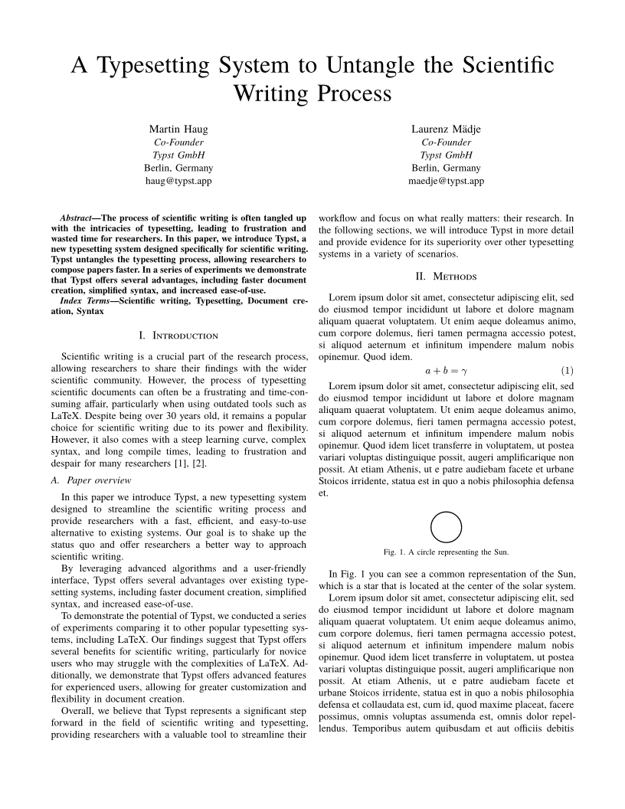
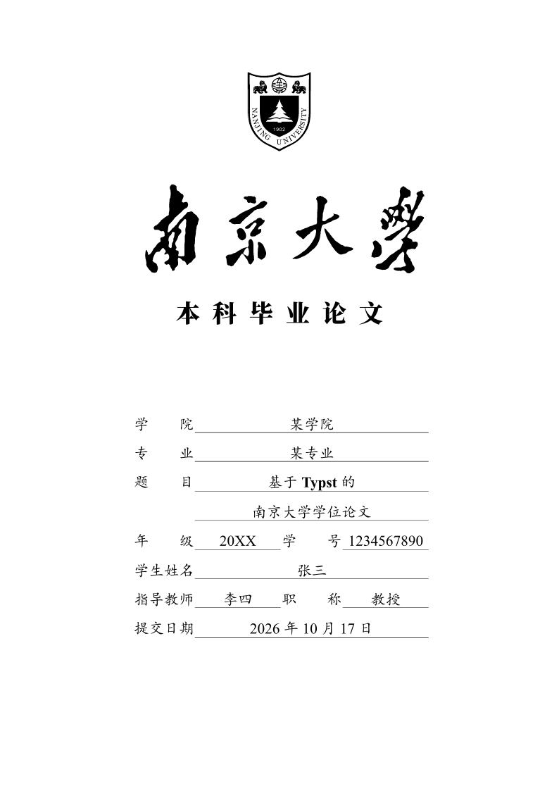
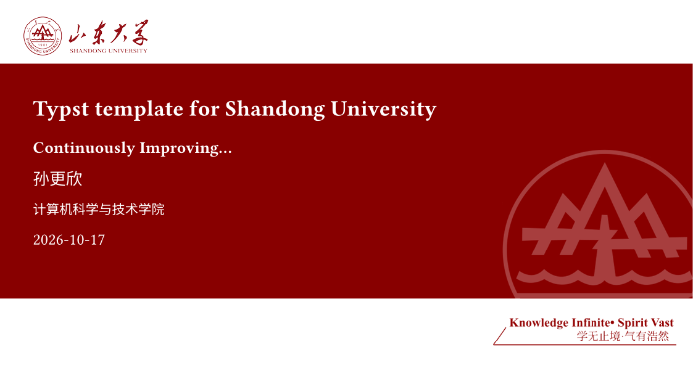

# Typst + TeX 中文排版模板库

一套开箱可用的中文学术排版模板集合：**Typst 81 个**（9 类）+ **LaTeX 40 个**（6 类）。每个模板都保留上游原文件、中文说明和编译好的预览图，克隆下来即可编译。

| Typst 模板 | LaTeX 模板 | 分类 | 预览 | 全量索引 |
|---:|---:|---:|---:|---:|
| 81 | 40 | 15 | 81 PNG + 81 PDF | 855 个包 |

两套排版体系物理分开、互不混杂：`Typst/` 只放 Typst，`TeX/` 只放 LaTeX / XeLaTeX。

## 快速开始

### 1. 克隆

```powershell
git clone https://github.com/weijianguizhou/typst-tex-templates.git
cd typst-tex-templates
```

### 2. 装编译器

| 需要什么 | 怎么装 |
|---|---|
| Typst ≥ 0.15.1 | `winget install --id Typst.Typst`，或从 [releases](https://github.com/typst/typst/releases) 下载 |
| TeX Live（仅 `TeX/` 需要） | 需含 `xelatex` 与 `latexmk` |
| 中文字体 | 用 `typst fonts` 查看已识别字体；缺字体时加 `--font-path <目录>` |

### 3. 编译第一个模板

```powershell
# Typst
cd Typst/01-学术论文/charged-ieee
typst compile --root . template/main.typ 我的论文.pdf

# LaTeX
cd TeX/01-学术论文与报告
latexmk -xelatex 学术论文模板.tex
```

Typst 首次编译会自动从 Typst Universe 下载 `@preview/...` 依赖，需要联网。

## 每个模板目录里有什么

| 文件 / 目录 | 说明 |
|---|---|
| `模板信息.md` | 中文说明、包版本、作者、许可、上游仓库、**可用编译命令** |
| `README.md` | 上游原始说明 |
| `LICENSE` | 上游许可证（若有） |
| `typst.toml` | 包清单：版本、入口文件、作者 |
| `template/` | 上游示例文档，**直接改这里** |
| `_预览/预览.pdf`、`预览.png` | 本库实测编译出的成品 |

> 编译报错、找入口、改字体时，先看对应目录的 `模板信息.md` —— 里面已针对该模板写过可用命令。

## 按用途找模板

| 你要做 | 推荐去处 | 编译方式 |
|---|---|---|
| 中文毕业论文 / 课程论文 | [`Typst/02-学位论文/`](Typst/02-学位论文/README.md) 或 [`TeX/01-学术论文与报告/`](TeX/01-学术论文与报告/学术论文模板.tex) | `typst compile` / `xelatex` |
| 英文期刊、会议投稿 | [`Typst/01-学术论文/`](Typst/01-学术论文/README.md) | `typst compile` |
| 课程笔记、讲义 | [`Typst/03-课程笔记/`](Typst/03-课程笔记/README.md) 或 [`TeX/05-课程笔记/`](TeX/05-课程笔记/README.md) | 两者均可 |
| 组会 / 答辩幻灯片 | [`Typst/04-幻灯片/`](Typst/04-幻灯片/README.md) 或 [`TeX/06-PPT演示/`](TeX/06-PPT演示/) | `typst compile` / `xelatex` |
| 简历 | [`Typst/05-简历CV/`](Typst/05-简历CV/README.md) 或 [`TeX/02-简历CV/`](TeX/02-简历CV/简历模板.tex) | 两者均可 |
| 学术海报 | [`Typst/06-海报/`](Typst/06-海报/README.md) | `typst compile` |
| 书稿 / 长讲义 | [`Typst/07-书籍与长文/`](Typst/07-书籍与长文/README.md) | `typst compile` |
| 公文、书信、邮件 | [`Typst/08-公文与书信/`](Typst/08-公文与书信/README.md) 或 [`TeX/03-公文与书信/`](TeX/03-公文与书信/) | 两者均可 |
| 试卷、作业、实验报告 | [`Typst/09-试卷作业与报告/`](Typst/09-试卷作业与报告/README.md) | `typst compile` |

## 预览

<table>
  <tr>
    <td align="center" width="50%">
      <br>
      <em>IEEE 会议论文</em>
    </td>
    <td align="center" width="50%">
      <br>
      <em>南京大学学位论文</em>
    </td>
  </tr>
  <tr>
    <td align="center" width="50%">
      <br>
      <em>答辩幻灯片</em>
    </td>
    <td align="center" width="50%">
      <br>
      <em>英文简历 CV</em>
    </td>
  </tr>
</table>

81 个模板全部实测编译成 PDF，每套的预览在各自 `_预览/` 目录下，也可在分类页里逐一看缩略图。

## Typst：81 个模板

- 总入口：[`Typst/README.md`](Typst/README.md)
- 全量目录：[`Typst/Typst-Universe-全量目录.md`](Typst/Typst-Universe-全量目录.md)（855 个带模板的包，含版本、说明、仓库、是否已下载）
- 可筛选版本：[`Typst/Typst-Universe-全量目录.csv`](Typst/Typst-Universe-全量目录.csv)
- 中文模板专项：[`Typst/中文模板索引.md`](Typst/中文模板索引.md)

81 个 = 80 个 [Typst Universe](https://typst.app/universe/) 精选模板 + 1 个本库自用笔记模板。

| 分类 | 数量 | 代表模板 |
|---|---:|---|
| [学术论文](Typst/01-学术论文/README.md) | 12 | IEEE、ACM、LNCS、Elsevier、Springer Nature、CVPR、NeurIPS、ICML、ACL、arXiv、中文论文 |
| [学位论文](Typst/02-学位论文/README.md) | 14 | 南大、上交、南科大、哈工大、清华、北大、东南、华师大、厦大、中山、电子科大、河海、吉大、北航 |
| [课程笔记](Typst/03-课程笔记/README.md) | 13 | inelegant-note、chengsi、zhaji、simple-handout、ilm、minimal-note、dvdtyp + 自用模板 |
| [幻灯片](Typst/04-幻灯片/README.md) | 10 | Touying 快速起步、Aqua、Metropolyst、上交 / 中山 / 清华 / 山东大学主题、极简演示 |
| [简历 CV](Typst/05-简历CV/README.md) | 10 | modern-cv、brilliant-cv、ATS 友好、学术 CV、中文单页简历 |
| [海报](Typst/06-海报/README.md) | 6 | peace-of-posters、placard、pollux、pasquino 等 |
| [书籍与长文](Typst/07-书籍与长文/README.md) | 4 | bookly、orange-book、min-book、latexy-book |
| [公文与书信](Typst/08-公文与书信/README.md) | 4 | GB/T 9704 公文、DIN 5008 信函、letterloom、学术信函 |
| [试卷作业与报告](Typst/09-试卷作业与报告/README.md) | 8 | 考试卷、作业题、实验报告、国赛数学建模 |

## TeX：6 类 11 个入口，全部实测可编译

- 总入口：[`TeX/README.md`](TeX/README.md)
- [01-学术论文与报告](TeX/01-学术论文与报告/)：论文骨架（摘要 / 数学 / 图表 / 引用 / 附录）
- [02-简历CV](TeX/02-简历CV/)：单页紧凑简历
- [03-公文与书信](TeX/03-公文与书信/)：正式公文 + 中文书信
- [04-演讲稿](TeX/04-演讲稿/)：LaTeX 讲稿 + Markdown 快速版
- [05-课程笔记](TeX/05-课程笔记/README.md)：李思风极简笔记（12 款封面）+ `textbook.cls` 分栏讲义
- [06-PPT演示](TeX/06-PPT演示/)：南理工 Beamer、钱学森学院 Beamer、PKU 极简 Beamer

每个模板目录都有 `模板信息.md`（入口 / 编译命令 / 字体依赖）与 `_预览/`（PDF + 首页 PNG）。

```powershell
cd TeX/01-学术论文与报告
latexmk -xelatex 学术论文模板.tex
```

## 目录结构

```text
typst-tex-templates/
├── README.md                 # 本页
├── TeX/                      # 只放 LaTeX / TeX
│   ├── README.md
│   ├── 01-学术论文与报告/
│   ├── 02-简历CV/
│   ├── 03-公文与书信/
│   ├── 04-演讲稿/
│   ├── 05-课程笔记/          # 李思风极简笔记/ + textbook分栏讲义/
│   └── 06-PPT演示/           # NJUST南理工/ + 钱学森学院/ + PKU极简/
├── Typst/                    # 只放 Typst
│   ├── README.md
│   ├── 01-学术论文/ … 09-试卷作业与报告/
│   ├── Typst-Universe-全量目录.md / .csv
│   └── 中文模板索引.md
└── _data/                    # 上游索引快照、精选清单、构建脚本
```

每个模板目录统一为：

```text
<分类>/<模板名>/
├── 模板信息.md        # 中文说明 / 版本 / 许可 / 入口 / 编译命令
├── README.md          # 上游原文
├── typst.toml         # 包清单
├── template/          # 示例文档，改这里
└── _预览/预览.pdf、预览.png
```

## 来源、版本与许可

- **Typst 模板**来自 [Typst Universe](https://typst.app/universe/) 的 `packages/preview` 归档；每个目录保留上游 `README.md`、`LICENSE`（若有）与 `typst.toml`，版本见 `模板信息.md`。
- 上游未附 `LICENSE` 的包，许可字段取自 Typst Universe 索引（MIT / GPL-3.0 等）。**再分发前请回上游仓库确认**。
- **TeX 模板**为原有模板与公开版本（PKU 极简 Beamer 等），版权与署名见各目录 `README.md`。
- **本仓库自有部分**（分类页、中文索引、`_data/` 构建脚本、自用笔记模板）以 MIT 许可提供。第三方模板的版权归各自作者，不在本声明范围内。
- 全量索引快照：`_data/typst-universe-index.json`；精选清单：`_data/curated.json`。

制作与测试环境：Typst 0.15.1 / Windows。

## 维护

重建索引、补齐下载、重编译预览：

```powershell
python _data/build_typst.py       # 抓取 Typst Universe 索引 + 补齐下载
python _data/compile_previews.py  # 编译并生成首页预览
python _data/fix_notes.py         # 修正编译说明、补缺失许可、写本地修正注记
python _data/make_indexes.py      # 重建分类页、中文索引、README
```
