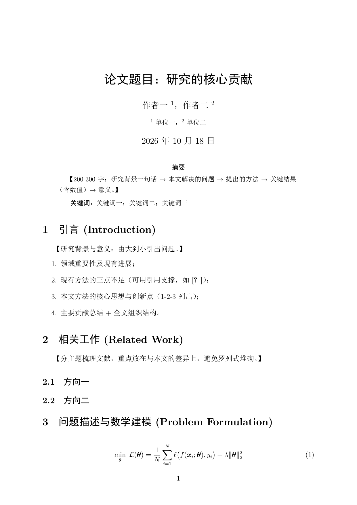
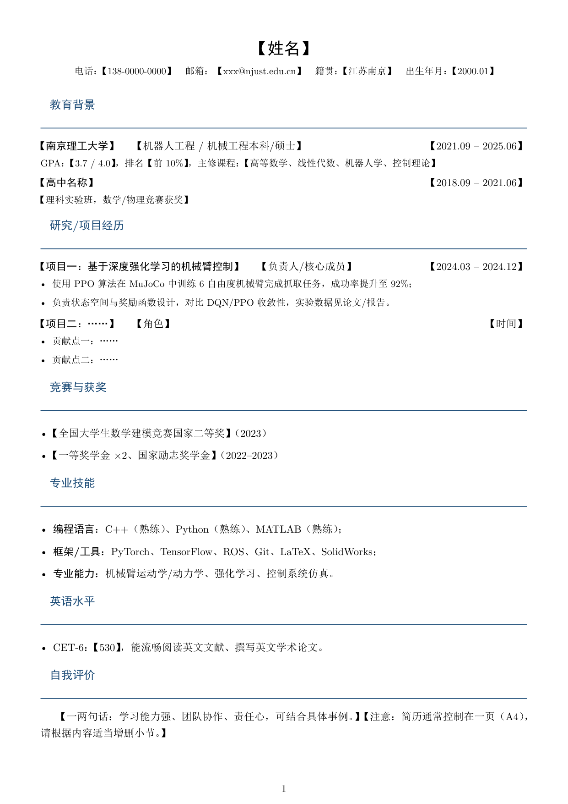
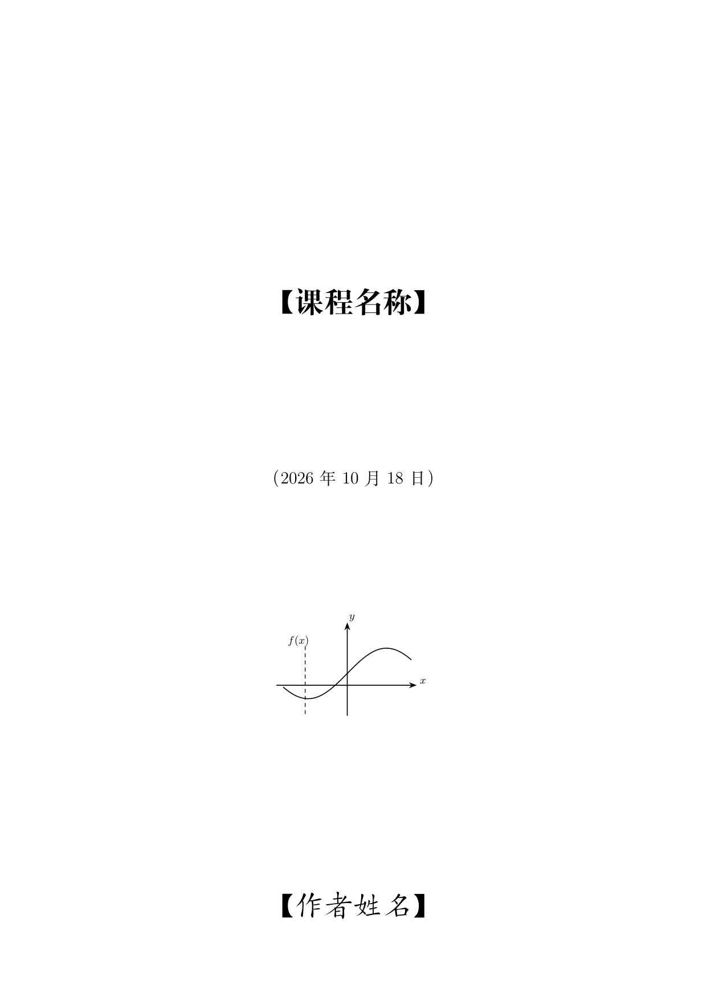
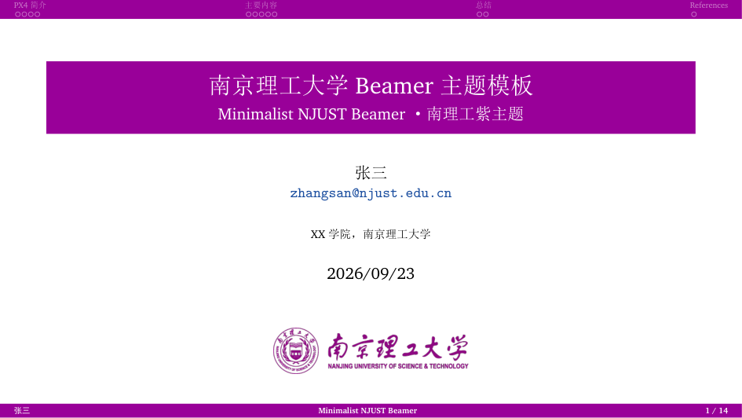

# TeX / LaTeX 模板

> 本目录只放 **LaTeX / XeLaTeX** 模板；Typst 模板在 [`../Typst/`](../Typst/README.md)。
> 中文模板统一用 **XeLaTeX** 编译；含目录 / 参考文献的要编译两遍，推荐 `latexmk -xelatex 主文件.tex`。

## 一览：11 个入口，全部实测可编译

| 分类 | 模板 | 入口文件 | 说明 |
|---|---|---|---|
| 01-学术论文与报告 | 学术论文模板 | [`学术论文模板.tex`](01-学术论文与报告/学术论文模板.tex) | 摘要、数学、图表、引用、附录的完整论文骨架 |
| 02-简历CV | 简历模板 | [`简历模板.tex`](02-简历CV/简历模板.tex) | 单页紧凑简历：教育、项目、获奖、技能 |
| 03-公文与书信 | 公文模板 | [`公文模板.tex`](03-公文与书信/公文模板.tex) | 正式公文排版 |
| 03-公文与书信 | 书信模板 | [`书信模板.tex`](03-公文与书信/书信模板.tex) | 中文书信 / 邮件 |
| 04-演讲稿 | 演讲稿模板 | [`演讲稿模板.tex`](04-演讲稿/演讲稿模板.tex) | 学术演讲、答辩讲稿；同目录有 Markdown 快速版 |
| 05-课程笔记 | 李思风极简笔记 | [`课程笔记模板.tex`](05-课程笔记/李思风极简笔记/课程笔记模板.tex) | `book` 类极简学术笔记，12 款可切换封面 |
| 05-课程笔记 | textbook 分栏讲义（中文） | [`cn-mynotes.tex`](05-课程笔记/textbook分栏讲义/cn-mynotes.tex) | `textbook.cls` 教材 / 长篇讲义，分栏多主题框 |
| 05-课程笔记 | textbook 分栏讲义（英文） | [`mynote.tex`](05-课程笔记/textbook分栏讲义/mynote.tex) | 同上，英文示例 |
| 06-PPT演示 | NJUST 南理工 Beamer | [`NJUST-slides.tex`](06-PPT演示/NJUST南理工/NJUST-slides.tex) | 南理工紫极简 Beamer，16:9 |
| 06-PPT演示 | 钱学森学院 Beamer | [`QXC-slides.tex`](06-PPT演示/钱学森学院/QXC-slides.tex) | 钱院洋红 Beamer，16:9 |
| 06-PPT演示 | PKU 极简 Beamer | [`main.tex`](06-PPT演示/PKU极简/main.tex) | 北大极简 Beamer 原版，上面两版的版式来源 |

每个模板目录都有 **`模板信息.md`**（入口 / 编译命令 / 字体依赖 / 目录说明）和 **`_预览/`**（本库实测编译的 PDF + 首页 PNG）。

## 预览

<table>
  <tr>
    <td align="center" width="33%">
      <br><em>学术论文</em>
    </td>
    <td align="center" width="33%">
      <br><em>单页简历</em>
    </td>
    <td align="center" width="33%">
      <br><em>李思风极简笔记</em>
    </td>
  </tr>
  <tr>
    <td align="center">
      <br><em>textbook 分栏讲义</em>
    </td>
    <td align="center">
      <br><em>NJUST Beamer</em>
    </td>
    <td align="center">
      <br><em>钱学森学院 Beamer</em>
    </td>
  </tr>
</table>

## 快速开始

1. 把整个模板子目录复制到新项目，保留同目录的图片、`.bib`、`.sty` / `.cls`；
2. 替换正文中的 `【】` 占位内容；
3. 用 VS Code + LaTeX Workshop 或 TeXstudio，编译器选 **XeLaTeX**；
4. 有目录 / 引用时编译两遍，或直接：

```powershell
latexmk -xelatex 主文件.tex
```

## 字体与依赖

- 中文：`ctex` + `xeCJK`；Windows 用 SimSun / SimHei，其他环境回退 Fandol（TeX Live 自带）；
- 数学：`amsmath`；图表：`graphicx` + `booktabs`；
- 参考文献：`natbib` / `biblatex`（以主文件为准）；
- `textbook分栏讲义` 原依赖方正字库，本库已改为**自动回退系统字体**，开箱即可编译；自备 `fonts/` 字库时自动恢复原效果。

## 维护

- 本目录按 `01-`…`06-` 编号分类，与 [`../Typst/`](../Typst/README.md) 的编号体系一致；
- 模板原 PDF 产物统一移到各自 `_预览/` 下，不再散落在模板目录；
- 分类变更后请同步更新本页表格与根目录 [`../README.md`](../README.md)。
