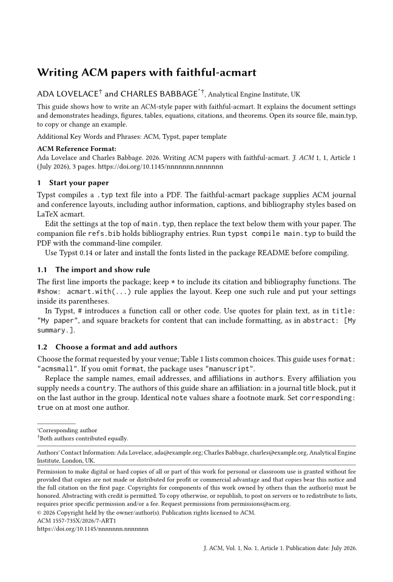
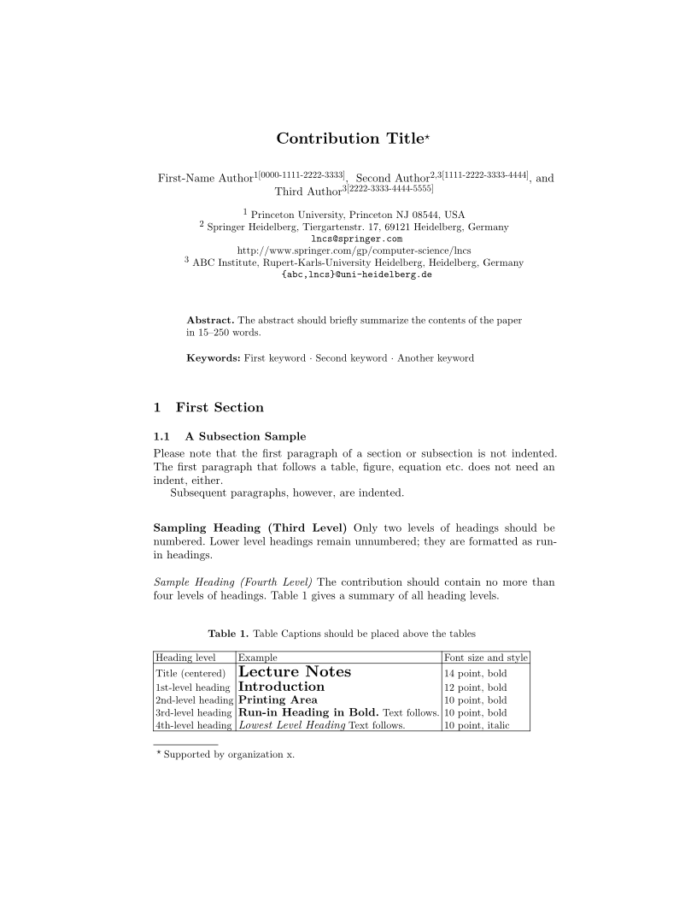
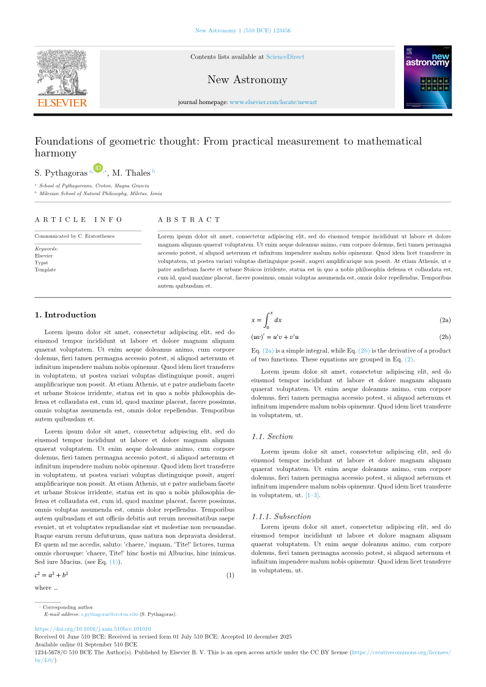
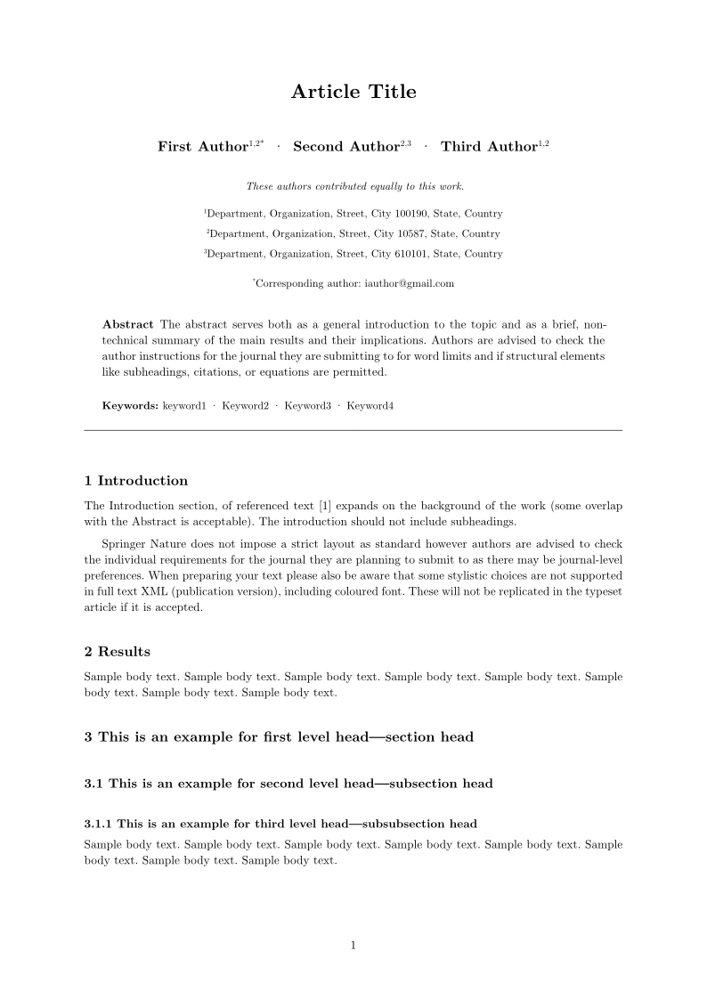
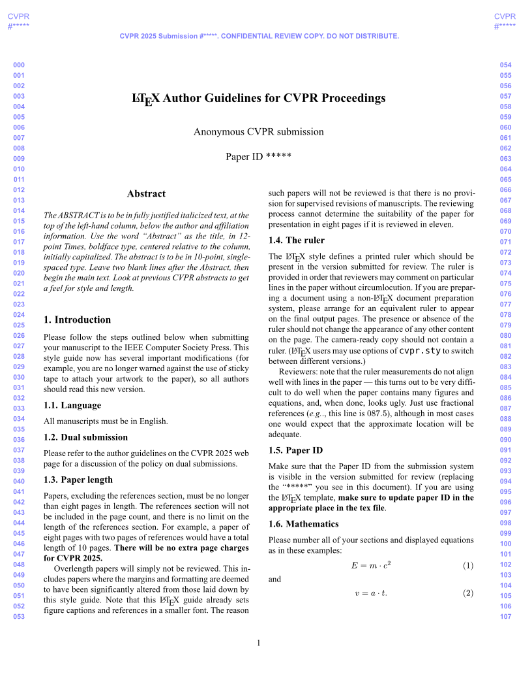
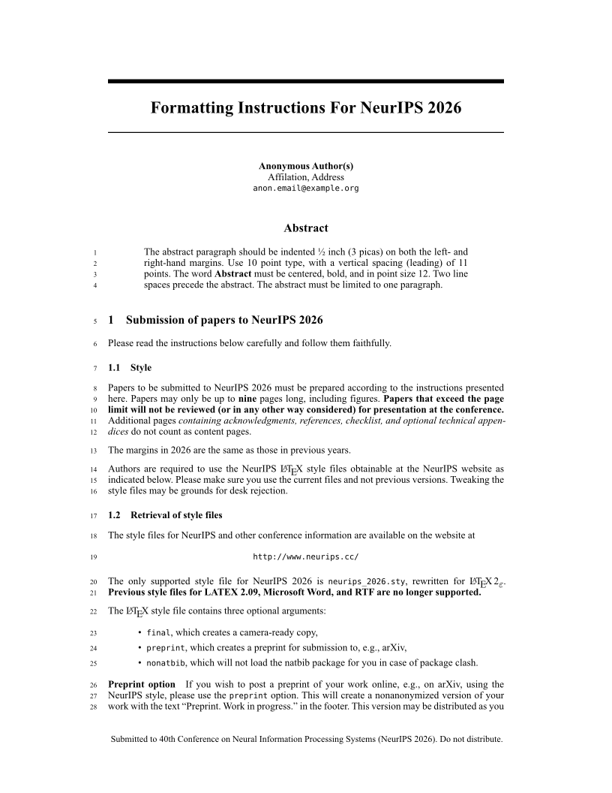
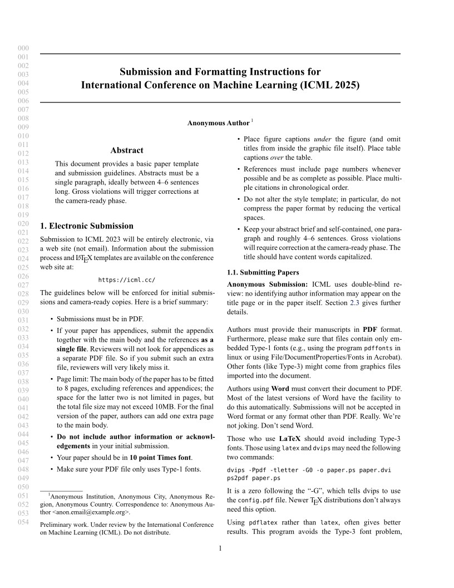

# 01-学术论文

> 期刊/会议论文，含 IEEE、ACM、LNCS、Elsevier、Springer Nature、CVPR、NeurIPS、ICML、ACL、arXiv 与中文论文排版。

| 模板 | 版本 | 简介 | 入口 | 编译 |
|---|---|---|---|---|
| [`charged-ieee`](./charged-ieee/) | 0.1.4 | An IEEE-style paper template to publish at conferences and journals for Electrical Engineering, Computer Sc… | [`template/main.typ`](<./charged-ieee/template/main.typ>) | ✓ |
| [`faithful-acmart`](./faithful-acmart/) | 0.2.0 | Every ACM paper format, matching LaTeX acmart. | [`template/main.typ`](<./faithful-acmart/template/main.typ>) | ✓ |
| [`fine-lncs`](./fine-lncs/) | 0.6.5 | A Springer's Lecture Notes in Computer Science (LNCS) styled template. | [`template/main.typ`](<./fine-lncs/template/main.typ>) | ✓ |
| [`elsevier-replica`](./elsevier-replica/) | 0.1.0 | Elsevier article template for Typst | [`template/main.typ`](<./elsevier-replica/template/main.typ>) | ✓ |
| [`stellar-springer-nature`](./stellar-springer-nature/) | 0.1.0 | Springer Nature journal article submission (sn-jnl class). | [`template/main.typ`](<./stellar-springer-nature/template/main.typ>) | ✓ |
| [`blind-cvpr`](./blind-cvpr/) | 0.7.0 | CVPR-style paper template to publish at the Computer Vision and Pattern Recognition (CVPR) conferences. | [`template/main.typ`](<./blind-cvpr/template/main.typ>) | ✓ |
| [`bloated-neurips`](./bloated-neurips/) | 0.8.0 | NeurIPS-style paper template to publish at the Conference and Workshop on Neural Information Processing Sys… | [`template/main.typ`](<./bloated-neurips/template/main.typ>) | ✓ |
| [`lucky-icml`](./lucky-icml/) | 0.7.0 | ICML-style paper template to publish at conferences for International Conference on Machine Learning | [`template/main.typ`](<./lucky-icml/template/main.typ>) | ✓ |
| [`tracl`](./tracl/) | 0.8.1 | Template for papers at *ACL conferences. | [`template/main.typ`](<./tracl/template/main.typ>) | ✓ |
| [`arkheion`](./arkheion/) | 0.1.2 | A simple template reproducing popular arXiv templates. | [`template/main.typ`](<./arkheion/template/main.typ>) | ✓ |
| [`easy-paper`](./easy-paper/) | 0.2.2 | A ready-to-use Typst template for Chinese papers | [`template/main.typ`](<./easy-paper/template/main.typ>) | ✓ |
| [`jastylest-zh`](./jastylest-zh/) | 0.1.2 | Article optimized for Chinese typesetting | [`template/document.typ`](<./jastylest-zh/template/document.typ>) | ✓ |

## 预览

> 编译状态为制作时在 Typst 0.15.1、Windows 中抽检的结果；缺少字体会产生 warning，不一定影响出 PDF。
