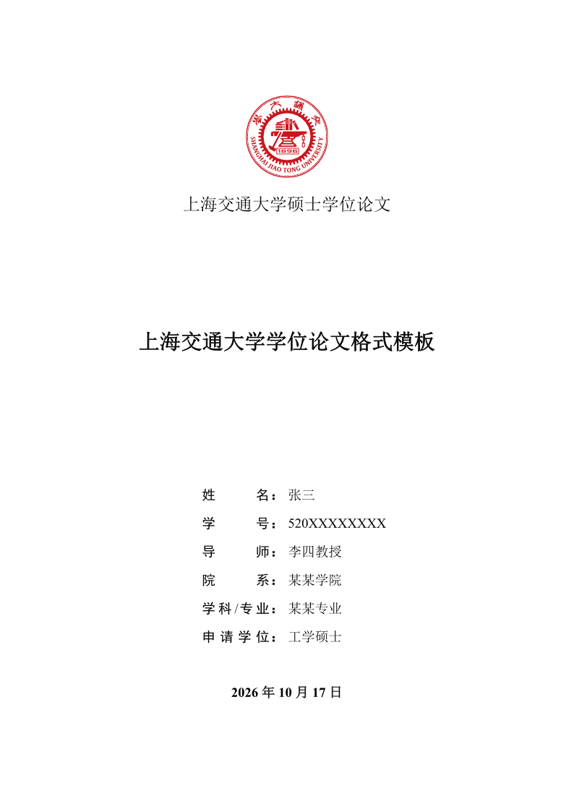
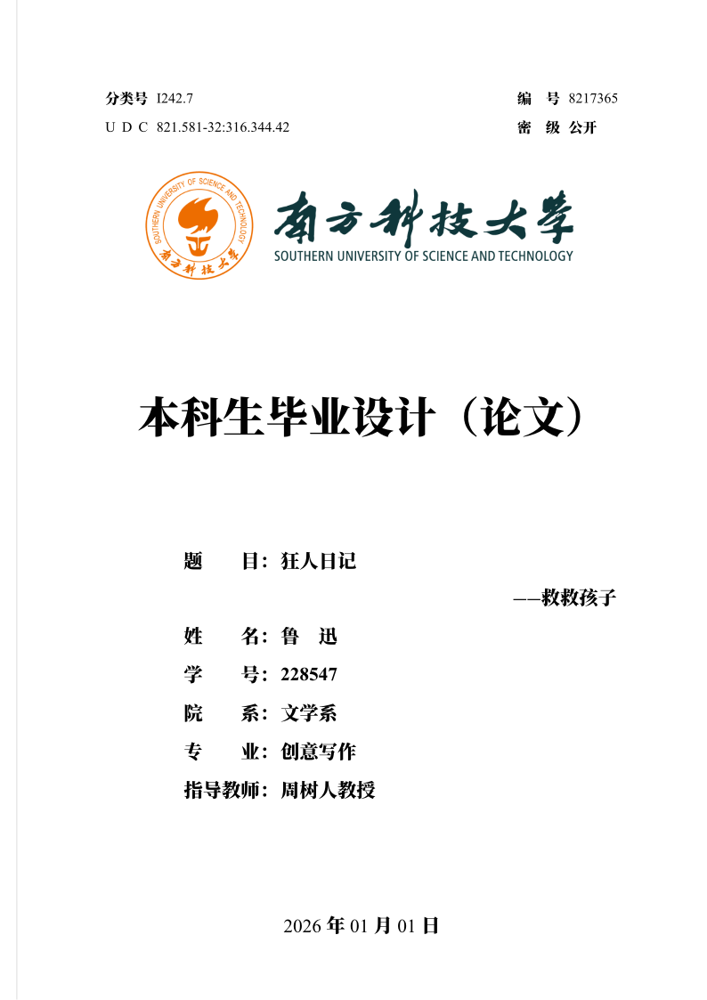
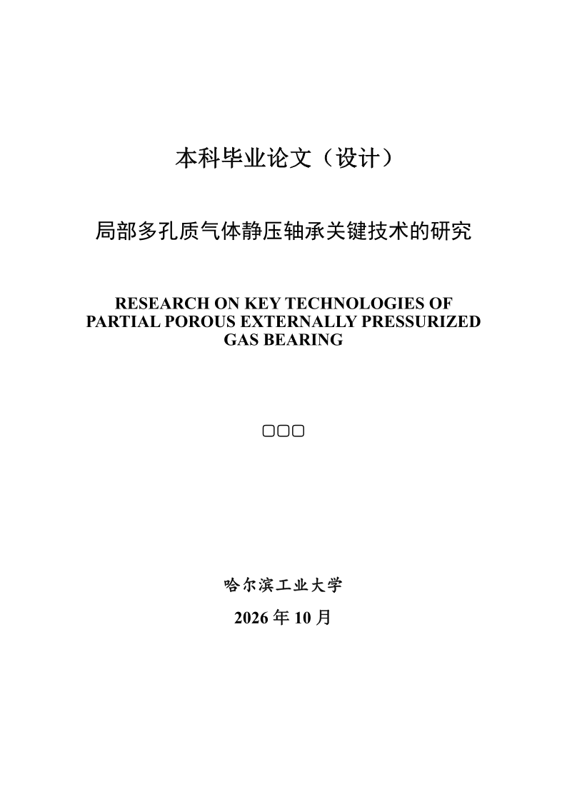
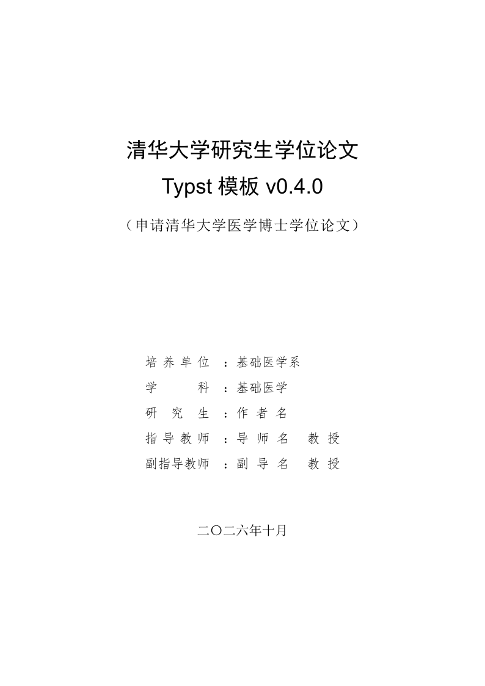
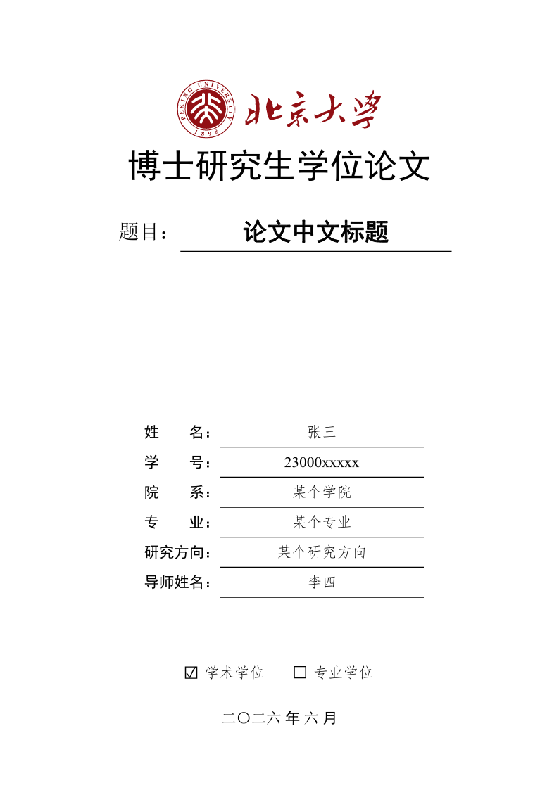
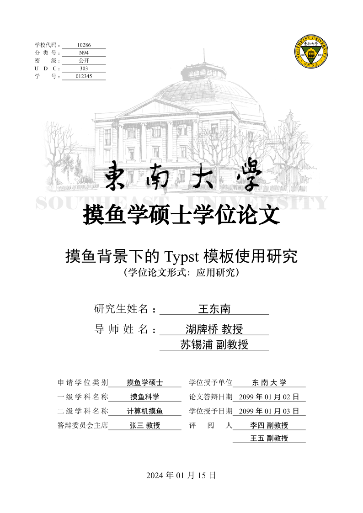
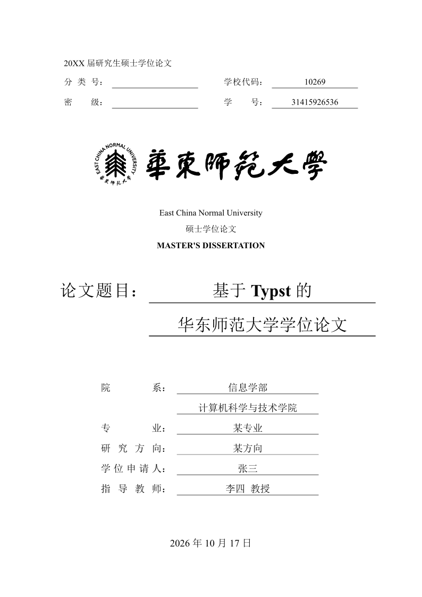

# 02-学位论文

> 中国高校学位论文模板为主，覆盖南大、上交、南科大、哈工大、清华、北大、东南、华师大、厦大、中山、电子科大、河海、吉大、北航。

| 模板 | 版本 | 简介 | 入口 | 编译 |
|---|---|---|---|---|
| [`modern-nju-thesis`](./modern-nju-thesis/) | 0.4.1 | 南京大学学位论文模板。Modern Nanjing University Thesis. | [`template/thesis.typ`](<./modern-nju-thesis/template/thesis.typ>) | ✓ |
| [`modern-sjtu-thesis`](./modern-sjtu-thesis/) | 0.6.2 | 上海交通大学学位论文模板。Shanghai Jiao Tong University Thesis Template. | [`template/thesis.typ`](<./modern-sjtu-thesis/template/thesis.typ>) | ✓ |
| [`modern-sustech-thesis`](./modern-sustech-thesis/) | 0.2.0 | 南方科技大学的学士、硕士、博士学位论文模版。 | [`template/bachelor.main.typ`](<./modern-sustech-thesis/template/bachelor.main.typ>) | ✓ |
| [`universal-hit-thesis`](./universal-hit-thesis/) | 0.3.0 | 哈尔滨工业大学学位论文模板 \| Universal Harbin Institute of Technology Thesis | [`templates/universal-bachelor.typ`](<./universal-hit-thesis/templates/universal-bachelor.typ>) | ✓ |
| [`uo-tsinghua-thesis`](./uo-tsinghua-thesis/) | 0.4.0 | An unofficial Typst template for Tsinghua University (THU) graduate thesis. 清华大学研究生毕业论文非官方Typst模板。 | [`template/正文.typ`](<./uo-tsinghua-thesis/template/正文.typ>) | ✓ |
| [`modern-pku-thesis`](./modern-pku-thesis/) | 0.2.3 | Dissertation template for Peking University (PKU). | [`template/main.typ`](<./modern-pku-thesis/template/main.typ>) | ✓ |
| [`cheda-seu-thesis`](./cheda-seu-thesis/) | 0.3.4 | 东南大学本科毕设与研究生学位论文模板。UNOFFICIAL Southeast University Thesis Template. | [`init-files/thesis.typ`](<./cheda-seu-thesis/init-files/thesis.typ>) | ✓ |
| [`modern-ecnu-thesis`](./modern-ecnu-thesis/) | 0.3.0 | 华东师范大学本科 / 研究生学位论文模板。Modern East China Normal University Thesis Template. | [`template/thesis.typ`](<./modern-ecnu-thesis/template/thesis.typ>) | ✓ |
| [`modern-xmu-thesis`](./modern-xmu-thesis/) | 0.2.2 | 厦门大学学位论文模板。Modern Xiamen University Thesis. | [`template/thesis.typ`](<./modern-xmu-thesis/template/thesis.typ>) | ✓ |
| [`modern-sysu-thesis`](./modern-sysu-thesis/) | 0.4.1 | 中山大学学位论文 Typst 模板，A Typst template for SYSU thesis | [`template/thesis.typ`](<./modern-sysu-thesis/template/thesis.typ>) | ✓ |
| [`modern-uestc-thesis`](./modern-uestc-thesis/) | 1.0.0 | 电子科技大学硕士学位论文模板.Modern UESTC Thesis Template. | [`template/main.typ`](<./modern-uestc-thesis/template/main.typ>) | ✓ |
| [`shane-hhu-thesis`](./shane-hhu-thesis/) | 0.6.0 | 河海大学本科生毕业论文（设计）模板。Unofficial Hohai University Undergraduate Thesis (Design) Template. | [`init-files/thesis.typ`](<./shane-hhu-thesis/init-files/thesis.typ>) | ✓ |
| [`universal-jlu-thesis`](./universal-jlu-thesis/) | 0.1.7 | 吉林大学毕业设计论文模板 \| Universal Jilin University Thesis | [`template/jlu-bachelor-thesis.typ`](<./universal-jlu-thesis/template/jlu-bachelor-thesis.typ>) | ✓ |
| [`modern-buaa-thesis`](./modern-buaa-thesis/) | 0.4.0 | A modern thesis template for BUAA. | [`template/thesis.typ`](<./modern-buaa-thesis/template/thesis.typ>) | ✓ |

## 预览

> 编译状态为制作时在 Typst 0.15.1、Windows 中抽检的结果；缺少字体会产生 warning，不一定影响出 PDF。
