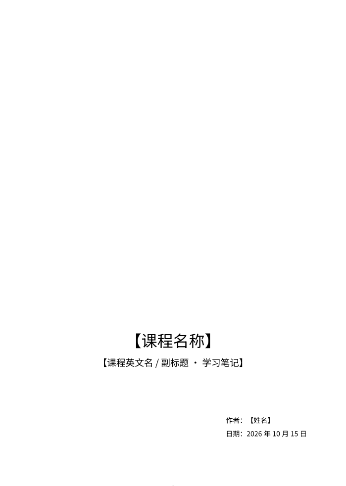
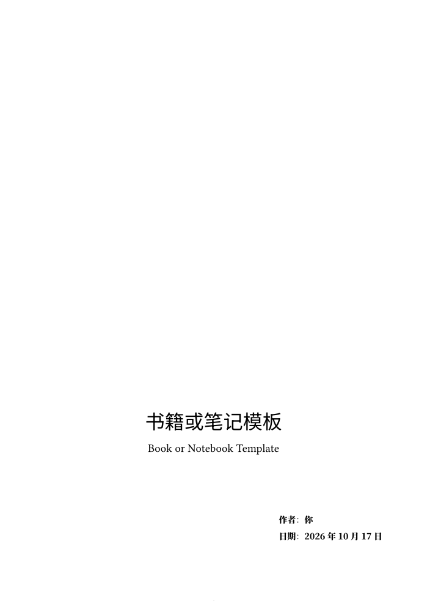
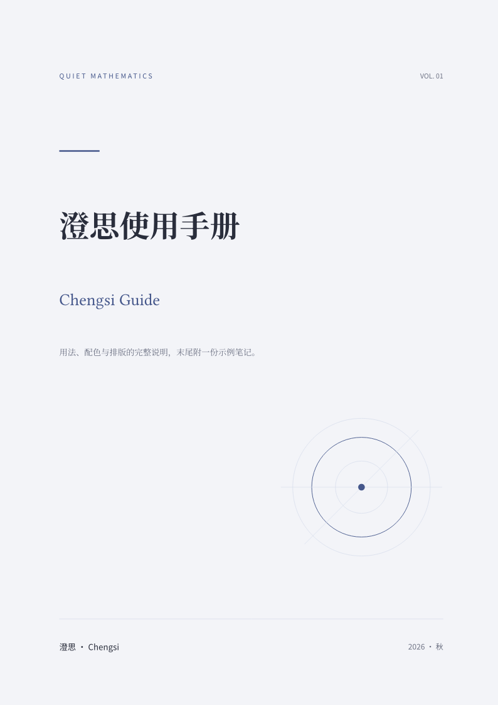
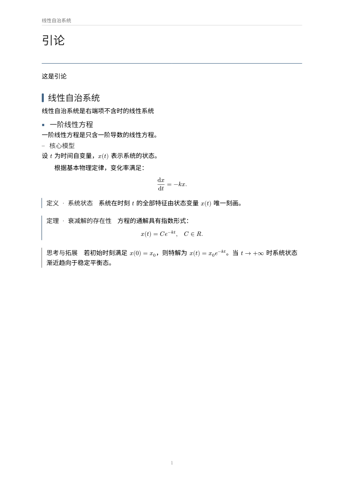
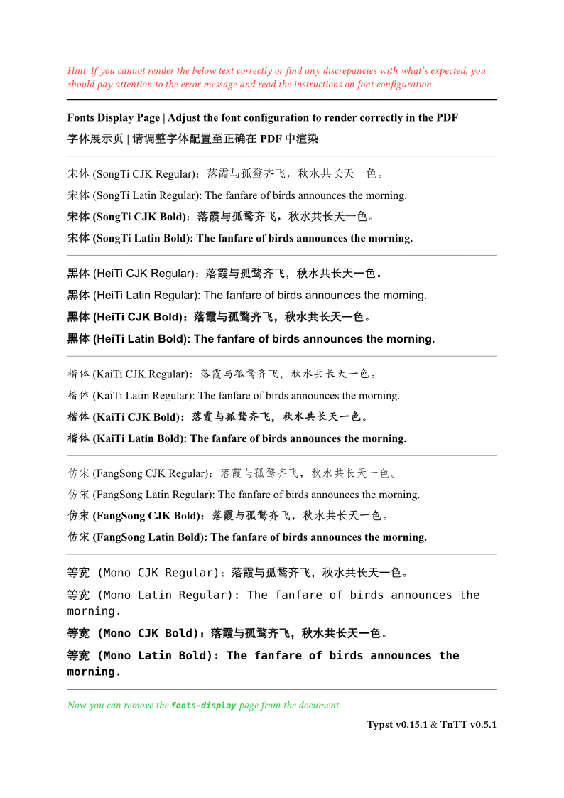
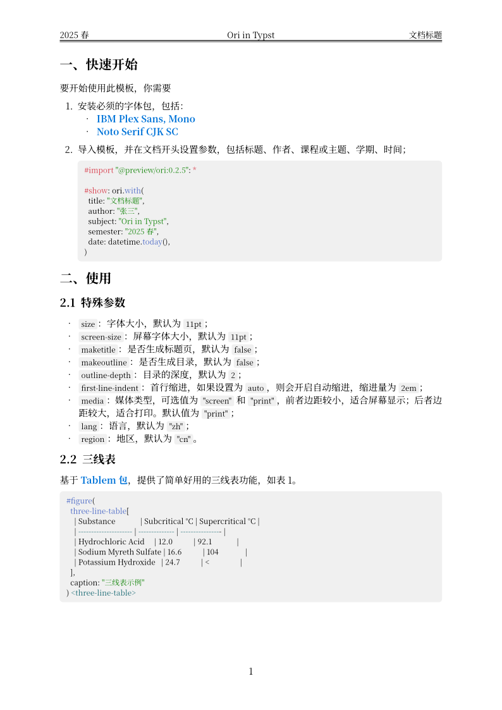
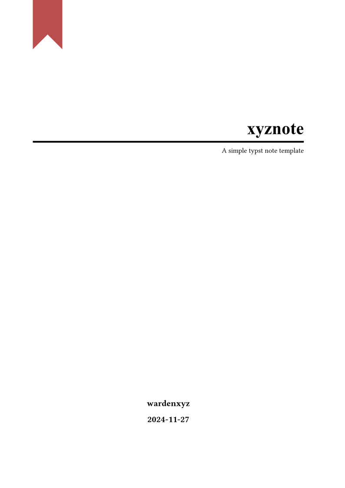
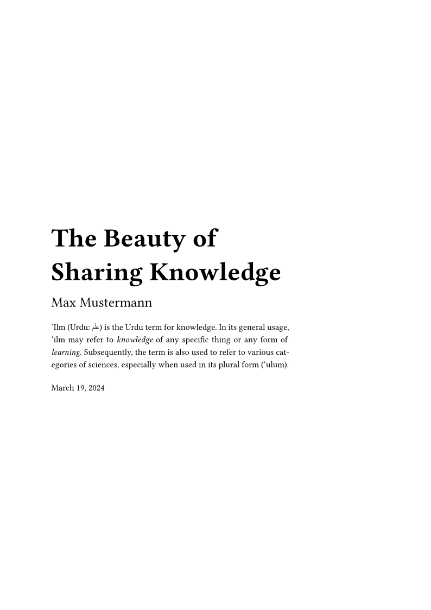
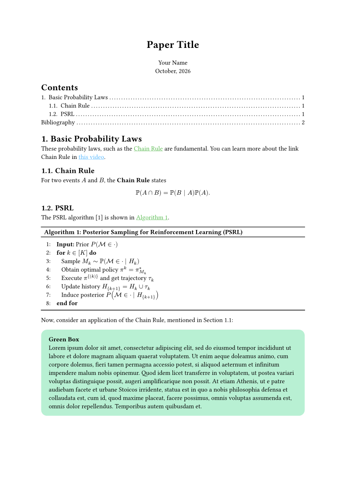

# 03-课程笔记

> 课程笔记、讲义、数学笔记与知识整理，含中文排版与 Elegant Book 风格。

| 模板 | 版本 | 简介 | 入口 | 编译 |
|---|---|---|---|---|
| [`inelegant-note`](./inelegant-note/) | 0.9.1 | A Typst template which has the feature of Elegant Book and others. | [`template/main.typ`](<./inelegant-note/template/main.typ>) | ✓ |
| [`chengsi`](./chengsi/) | 0.1.2 | Chinese and English mathematics notes in three palettes. | [`template/main.typ`](<./chengsi/template/main.typ>) | ✓ |
| [`zhaji`](./zhaji/) | 0.1.0 | Clean, restrained academic lecture notes and book template. | [`template/main.typ`](<./zhaji/template/main.typ>) | ✓ |
| [`simple-handout`](./simple-handout/) | 0.2.0 | A simple handout template for Chinese typesetting based on TnTT. | [`template/main.typ`](<./simple-handout/template/main.typ>) | ✓ |
| [`ori`](./ori/) | 0.2.5 | Simple enough but expressive template for notes, reports, and documents in Chinese and English. | [`template/main.typ`](<./ori/template/main.typ>) | ✓ |
| [`xyznote`](./xyznote/) | 0.5.0 | Simple and Functional Typst Note Template | [`template/main.typ`](<./xyznote/template/main.typ>) | ✓ |
| [`ilm`](./ilm/) | 2.1.1 | Versatile and minimal template for non-fiction writing. Ideal for class notes, reports, and books | [`template/main.typ`](<./ilm/template/main.typ>) | ✓ |
| [`minimal-note`](./minimal-note/) | 0.10.1 | Notes with colorful minimalism. | [`template/main.typ`](<./minimal-note/template/main.typ>) | ✓ |
| [`mousse-notes`](./mousse-notes/) | 2.0.1 | Elegant lecture notes inspired by old math books. | [`template/main.typ`](<./mousse-notes/template/main.typ>) | ✓ |
| [`lambda-notes`](./lambda-notes/) | 0.1.0 | Clean template for university computer science notes. | [`template/main.typ`](<./lambda-notes/template/main.typ>) | ✓ |
| [`dvdtyp`](./dvdtyp/) | 1.0.1 | a colorful template for writting handouts or notes | [`template/main.typ`](<./dvdtyp/template/main.typ>) | ✓ |
| [`obelisk`](./obelisk/) | 0.2.0 | A high-precision, print-ready, Bauhaus-inspired note-taking template. | [`template/main.typ`](<./obelisk/template/main.typ>) | ✓ |
| [`我的课程笔记-inelegant-note`](./我的课程笔记-inelegant-note/) | 自用 | 本库自用的中文课程笔记模板（inelegant-note 五色盒、注记盒、三线表） | [`笔记模板1.typ`](<./我的课程笔记-inelegant-note/笔记模板1.typ>) | ✓ |

## 预览

> 编译状态为制作时在 Typst 0.15.1、Windows 中抽检的结果；缺少字体会产生 warning，不一定影响出 PDF。
