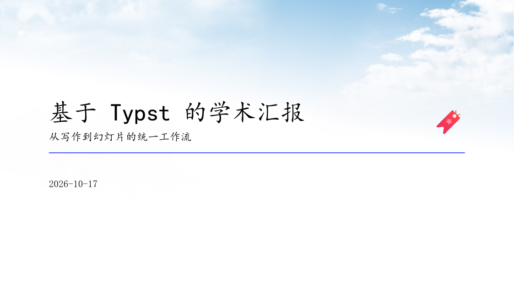
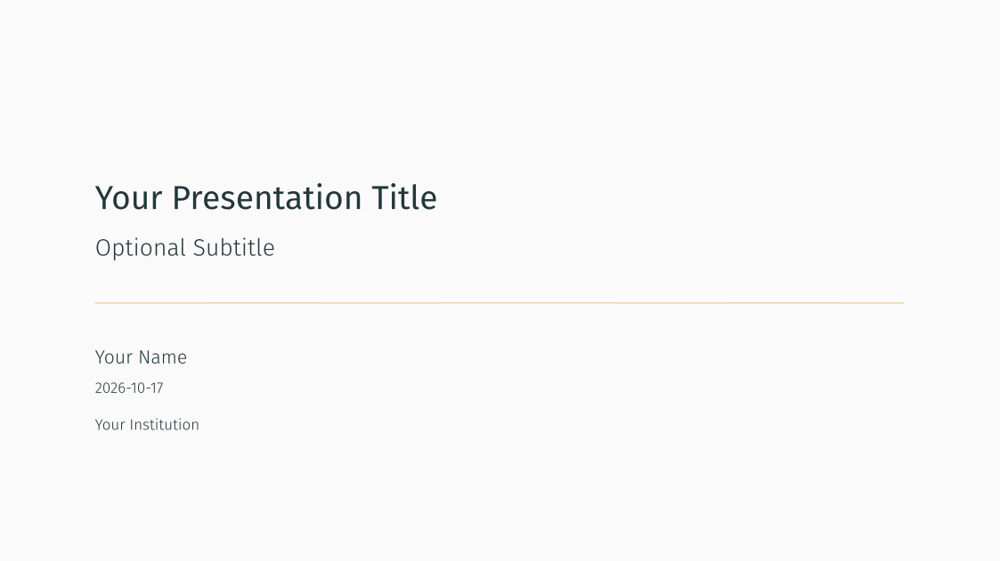
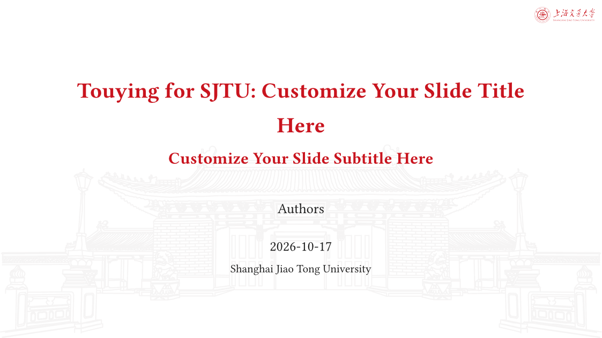
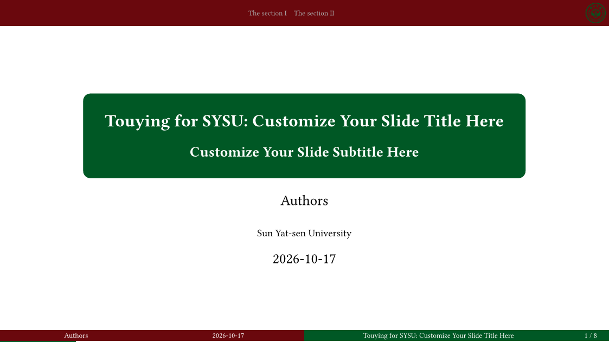

# 04-幻灯片

> Touying / Polylux / 极简演示文稿，含上交、中山、清华、山东大学等中文主题。

| 模板 | 版本 | 简介 | 入口 | 编译 |
|---|---|---|---|---|
| [`touying-quick`](./touying-quick/) | 0.5.0 | A quick-start template based on touying for academic reports | [`template/main.typ`](<./touying-quick/template/main.typ>) | ✓ |
| [`touying-aqua`](./touying-aqua/) | 0.8.0 | A powerful package for creating presentation slides. | [`template/main.typ`](<./touying-aqua/template/main.typ>) | ✓ |
| [`metropolyst`](./metropolyst/) | 0.1.0 | Configurable Metropolis presentation theme for Touying. | [`template/main.typ`](<./metropolyst/template/main.typ>) | ✓ |
| [`touying-simpl-sjtu`](./touying-simpl-sjtu/) | 0.1.0 | 上海交通大学 Touying 幻灯片主题 (Touying Slide Theme for SJTU) | [`template/main.typ`](<./touying-simpl-sjtu/template/main.typ>) | ✓ |
| [`modern-sysu-touying`](./modern-sysu-touying/) | 0.1.0 | 中山大学幻灯片 Typst 模板，A Typst template for SYSU presentation | [`template/touying.typ`](<./modern-sysu-touying/template/touying.typ>) | ✓ |
| [`shuimu-touying`](./shuimu-touying/) | 0.5.0 | Beamer-style Touying slides in Tsinghua purple | [`template/main.typ`](<./shuimu-touying/template/main.typ>) | ✓ |
| [`sdu-touying-simpl`](./sdu-touying-simpl/) | 1.1.0 | A Touying-based presentation template designed for Shandong University (SDU). | [`example/main.typ`](<./sdu-touying-simpl/example/main.typ>) | ✓ |
| [`minimal-presentation`](./minimal-presentation/) | 0.7.0 | A modern minimalistic presentation template ready to use | [`template/main.typ`](<./minimal-presentation/template/main.typ>) | ✓ |
| [`diatypst`](./diatypst/) | 0.9.3 | easy slides in typst - sensible defaults, easy syntax, well styled | [`template/main.typ`](<./diatypst/template/main.typ>) | ✓ |
| [`typslides`](./typslides/) | 1.3.4 | Minimalistic slides. | [`template/main.typ`](<./typslides/template/main.typ>) | ✓ |

## 预览

> `touying-quick` 上游是空白起步模板；预览由 `_预览/示例.typ` 填充演示内容后生成。

> 编译状态为制作时在 Typst 0.15.1、Windows 中抽检的结果；缺少字体会产生 warning，不一定影响出 PDF。
