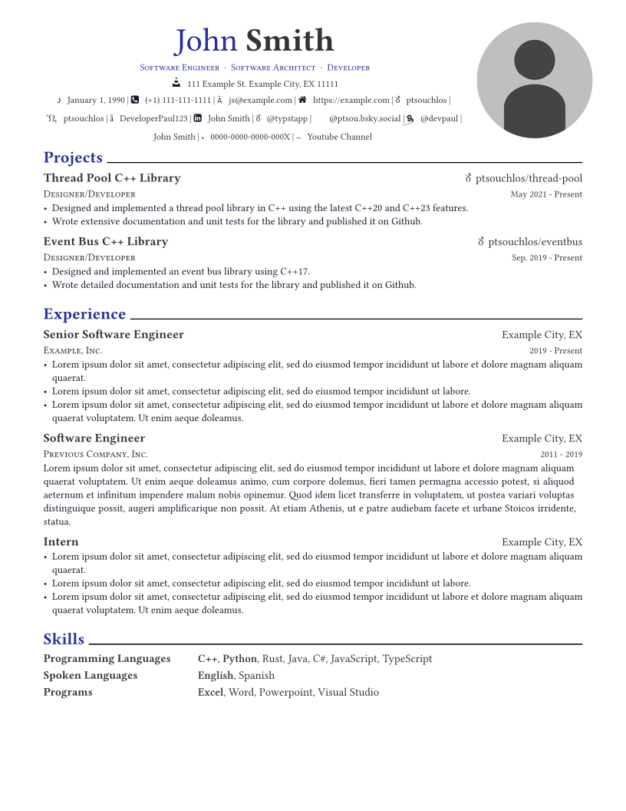
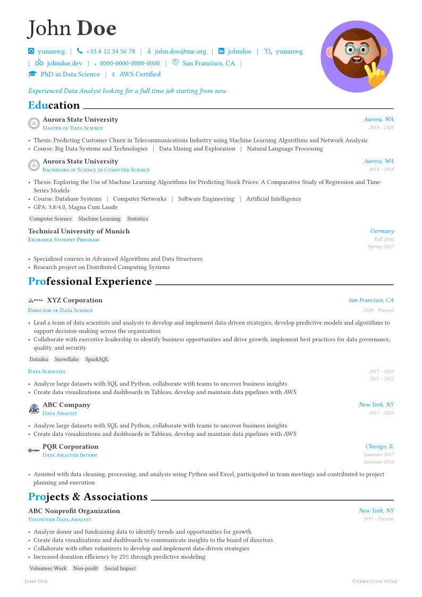
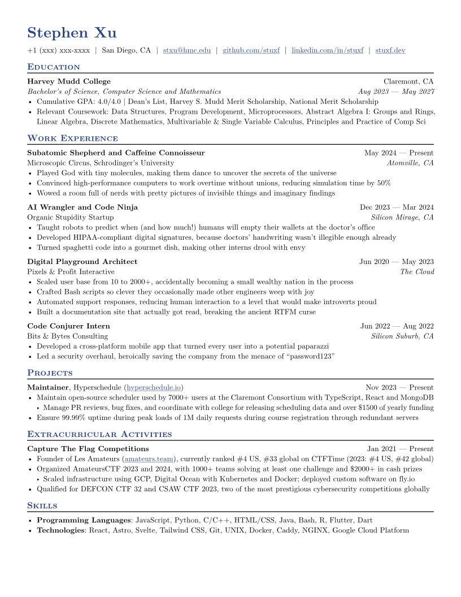
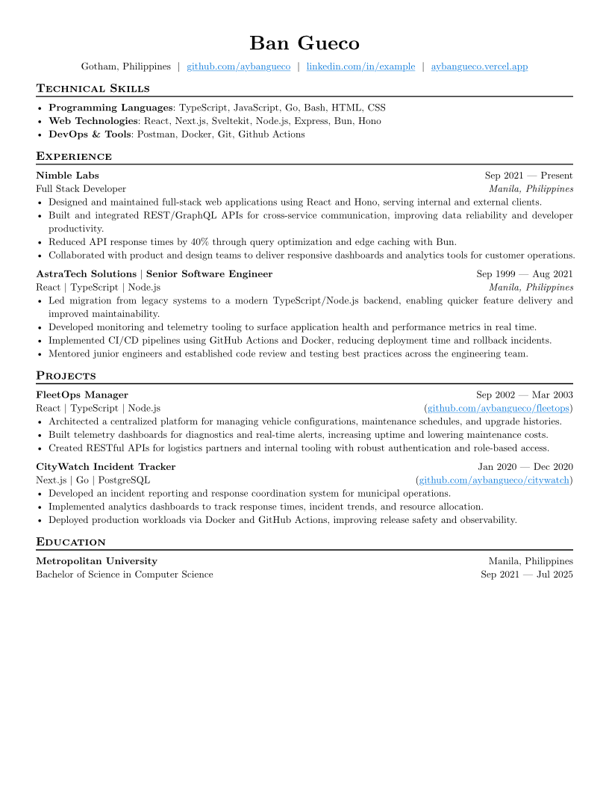
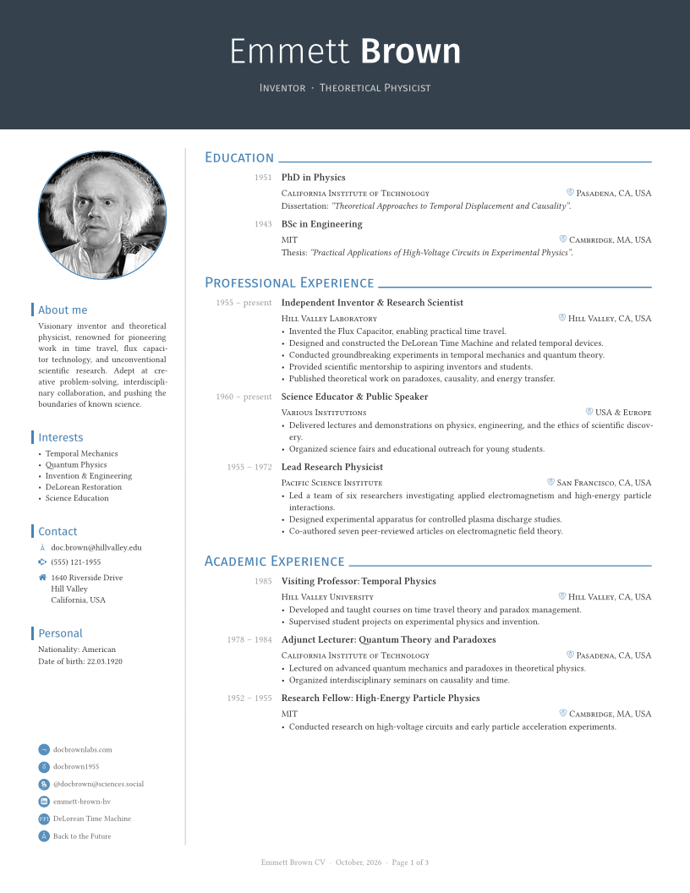
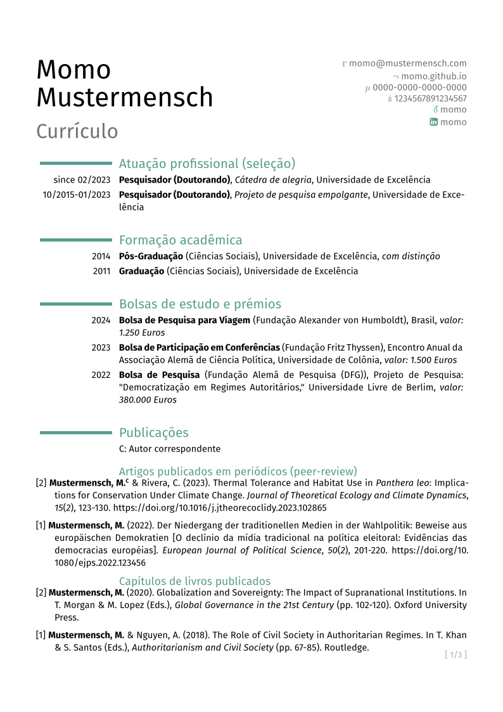
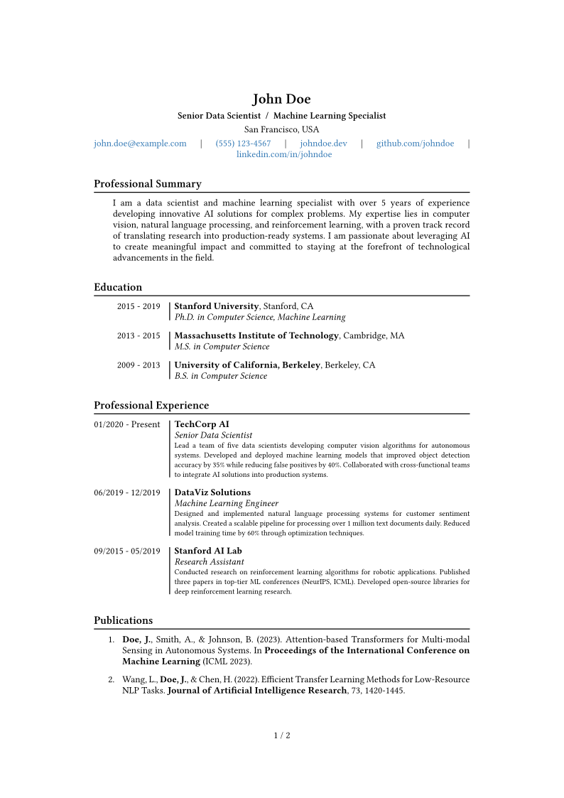
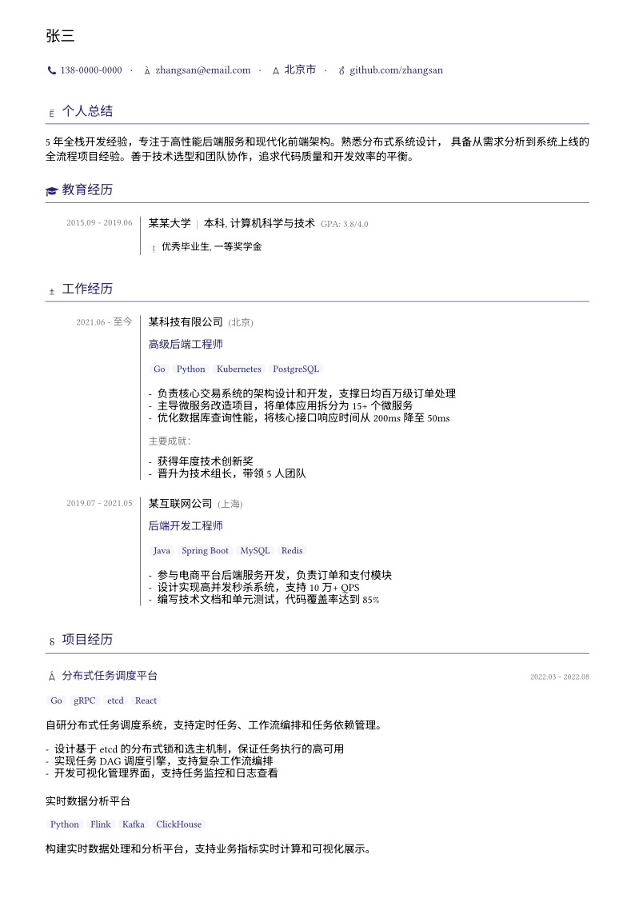

# 05-简历CV

> 学术简历、ATS 友好简历、单页中文简历与多语言简历。

| 模板 | 版本 | 简介 | 入口 | 编译 |
|---|---|---|---|---|
| [`modern-cv`](./modern-cv/) | 0.10.0 | A modern resume template based on the Awesome-CV Latex template. | [`template/resume.typ`](<./modern-cv/template/resume.typ>) | ✓ |
| [`brilliant-cv`](./brilliant-cv/) | 4.1.1 | 💼 Modular, multilingual CV and cover letter template | [`template/cv.typ`](<./brilliant-cv/template/cv.typ>) | ✓ |
| [`basic-resume`](./basic-resume/) | 0.2.9 | A simple, standard resume, designed to work well with ATS. | [`template/main.typ`](<./basic-resume/template/main.typ>) | ✓ |
| [`ats-friendly-resume`](./ats-friendly-resume/) | 0.1.1 | A simple ats friendly resume built for developers. | [`template/main.typ`](<./ats-friendly-resume/template/main.typ>) | ✓ |
| [`neat-cv`](./neat-cv/) | 1.2.0 | A modern and elegant CV template, inspired by Awesome CV and simple-hisptercv. | [`template/cv.typ`](<./neat-cv/template/cv.typ>) | ✓ |
| [`modern-acad-cv`](./modern-acad-cv/) | 0.1.5 | A CV template for academics based on moderncv LaTeX package. | [`template/example.typ`](<./modern-acad-cv/template/example.typ>) | ✓ |
| [`academicv`](./academicv/) | 1.1.0 | A clean, flexible curriculum vitae (CV) template using Typst and YAML | [`template/template.typ`](<./academicv/template/template.typ>) | ✓ |
| [`golixp-resume-zh-cn`](./golixp-resume-zh-cn/) | 0.1.2 | 面向简体中文的模块化 Typst 简历模板，支持自定义主题色、字体和排版配置 | [`template/main.typ`](<./golixp-resume-zh-cn/template/main.typ>) | ✓ |
| [`habaneraa-one-page-resume-zh`](./habaneraa-one-page-resume-zh/) | 0.1.0 | Fit your resume perfectly on one page by tuning one parameter. | [`template/main.typ`](<./habaneraa-one-page-resume-zh/template/main.typ>) | ✓ |
| [`bone-resume`](./bone-resume/) | 0.3.1 | A colorful resume template for chinese. | [`template/main.typ`](<./bone-resume/template/main.typ>) | ✓ |

## 预览

> 编译状态为制作时在 Typst 0.15.1、Windows 中抽检的结果；缺少字体会产生 warning，不一定影响出 PDF。
