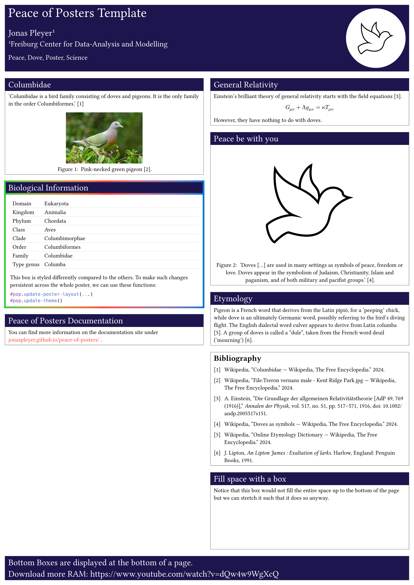
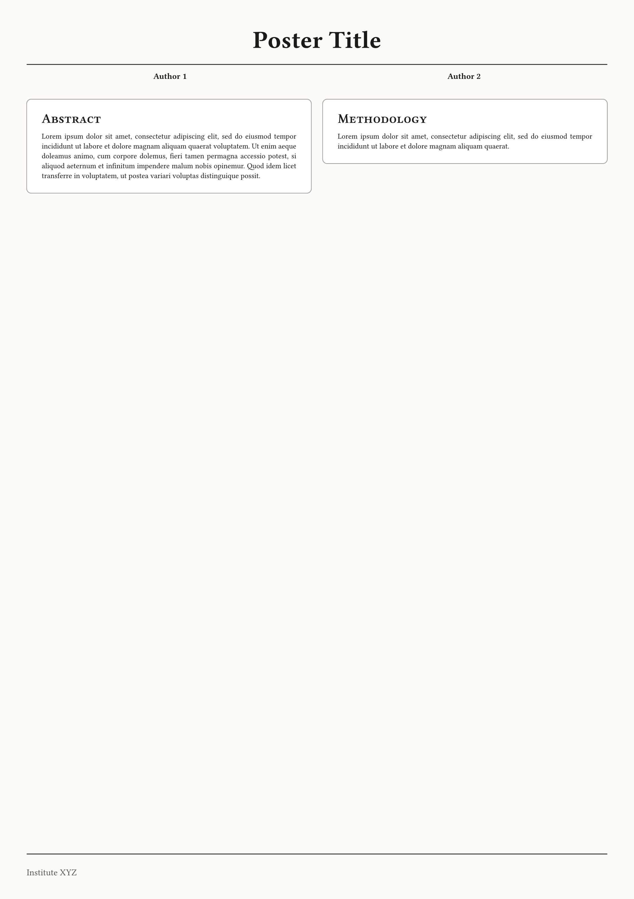
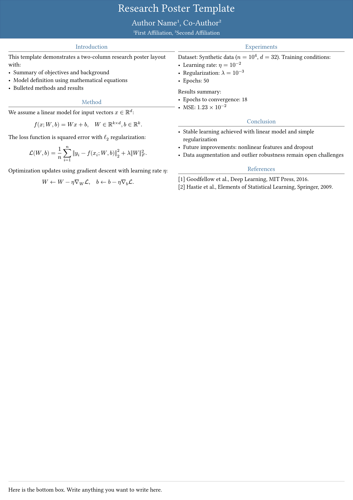
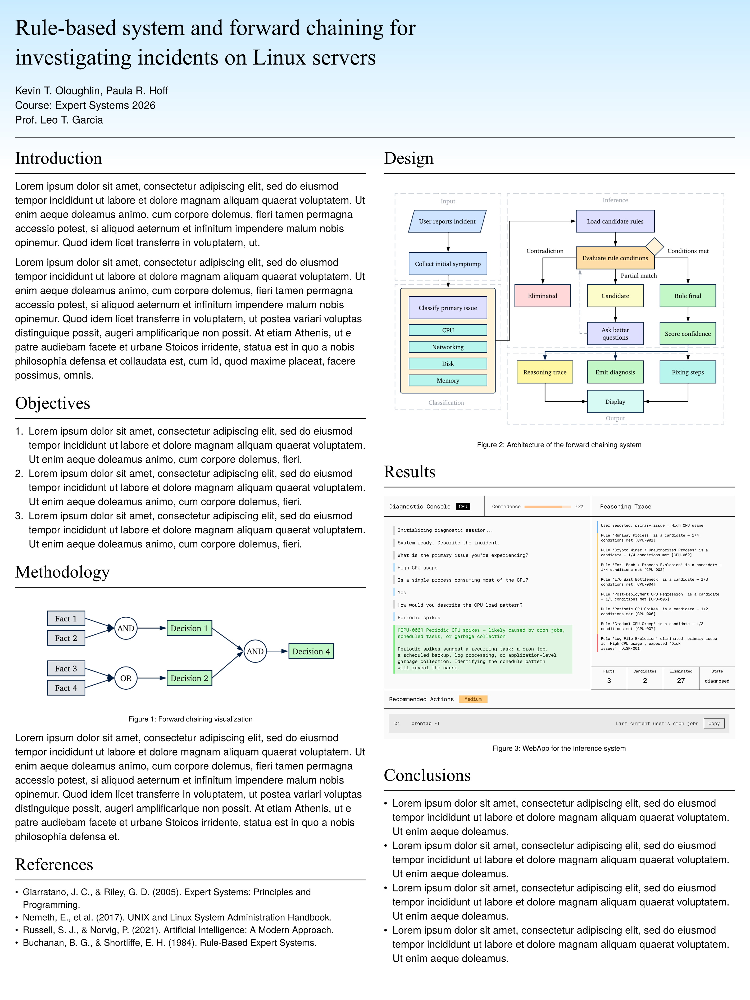
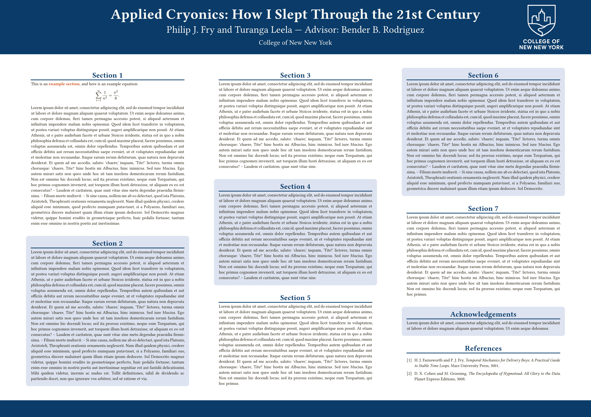
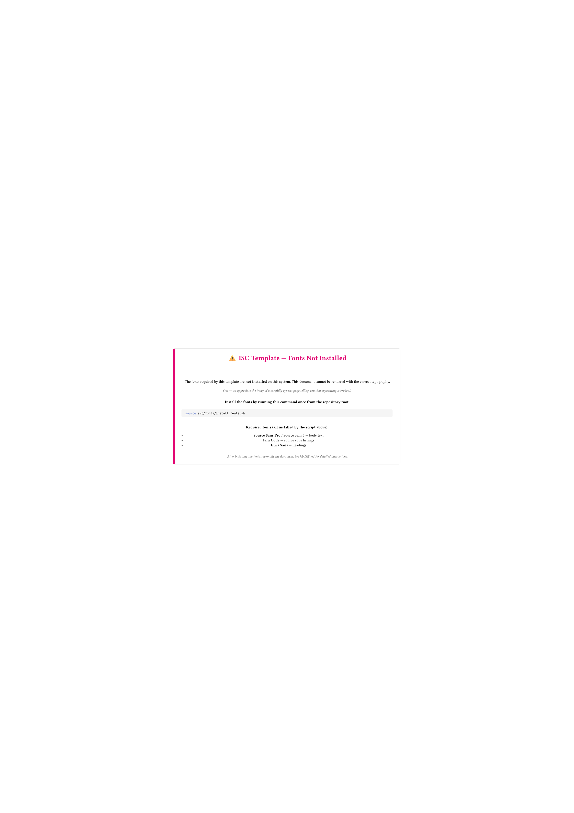

# 06-海报

> 会议 poster、A0/A1 学术海报与模块化网格布局。

| 模板 | 版本 | 简介 | 入口 | 编译 |
|---|---|---|---|---|
| [`peace-of-posters`](./peace-of-posters/) | 0.6.0 | Create scientific posters in Typst. | [`templates/pop-uni-fr-poster/main.typ`](<./peace-of-posters/templates/pop-uni-fr-poster/main.typ>) | ✓ |
| [`placard`](./placard/) | 0.1.0 | A versatile scientific poster package with modular grid layouts. | [`template/main.typ`](<./placard/template/main.typ>) | ✓ |
| [`pollux`](./pollux/) | 0.1.0 | A clean and minimal academic poster template inspired by gemini. | [`template/main.typ`](<./pollux/template/main.typ>) | ✓ |
| [`pasquino`](./pasquino/) | 0.1.0 | Academic conference posters with themed gradients. | [`template/main.typ`](<./pasquino/template/main.typ>) | ✓ |
| [`simple-research-poster`](./simple-research-poster/) | 0.2.0 | Simple research poster. | [`template/poster.typ`](<./simple-research-poster/template/poster.typ>) | ✓ |
| [`isc-hei-poster`](./isc-hei-poster/) | 0.8.1 | Official A1 poster template (portrait and landscape) for the 'Informatique et systèmes de communication' (I… | [`src/poster.typ`](<./isc-hei-poster/src/poster.typ>) | ✓ |

## 预览

> 编译状态为制作时在 Typst 0.15.1、Windows 中抽检的结果；缺少字体会产生 warning，不一定影响出 PDF。
