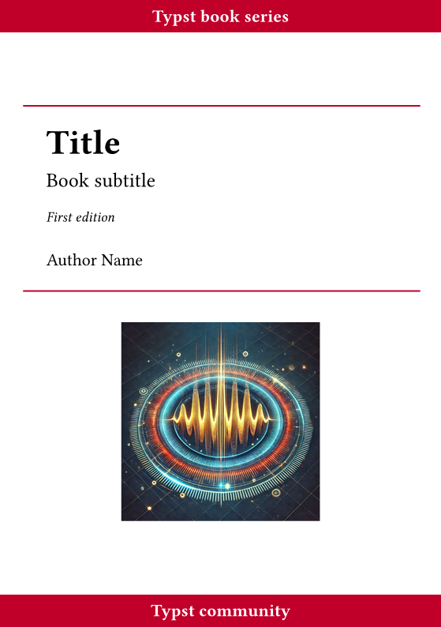
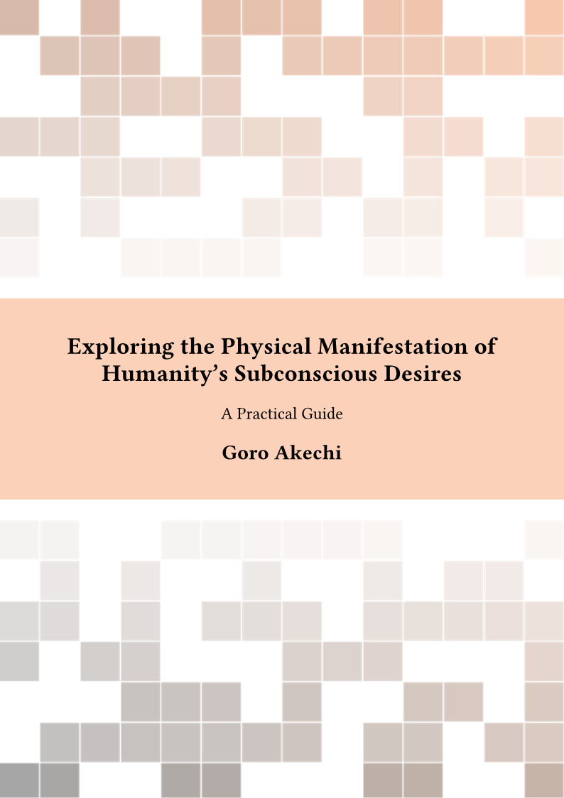
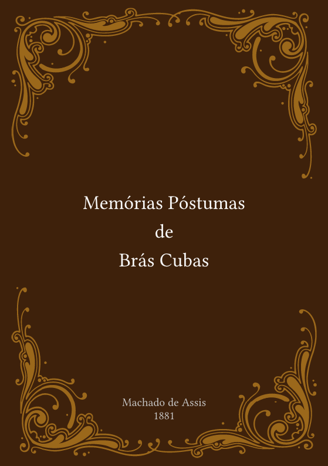
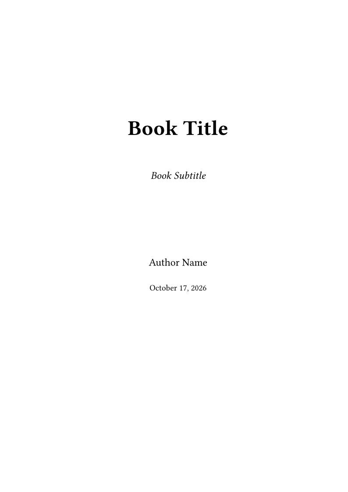

# 07-书籍与长文

> 书稿、讲义成书、经典 LaTeX 书籍样式的 Typst 复刻。

| 模板 | 版本 | 简介 | 入口 | 编译 |
|---|---|---|---|---|
| [`bookly`](./bookly/) | 5.2.0 | A clean, customizable template for writing and publishing structured books with front matter, chapters, and… | [`template/main.typ`](<./bookly/template/main.typ>) | ✓ |
| [`orange-book`](./orange-book/) | 0.7.1 | A book template inspired by The Legrand Orange Book of Mathias Legrand and Vel | [`template/main.typ`](<./orange-book/template/main.typ>) | ✓ |
| [`min-book`](./min-book/) | 1.5.1 | Simple and complete books without introducing new syntax | [`template/main.typ`](<./min-book/template/main.typ>) | ✓ |
| [`latexy-book`](./latexy-book/) | 0.0.2 | A LaTeX-style book template: part/chapter/section structure, frontmatter/mainmatter/appendix/backmatter, th… | [`template/main.typ`](<./latexy-book/template/main.typ>) | ✓ |

## 预览

> 编译状态为制作时在 Typst 0.15.1、Windows 中抽检的结果；缺少字体会产生 warning，不一定影响出 PDF。
