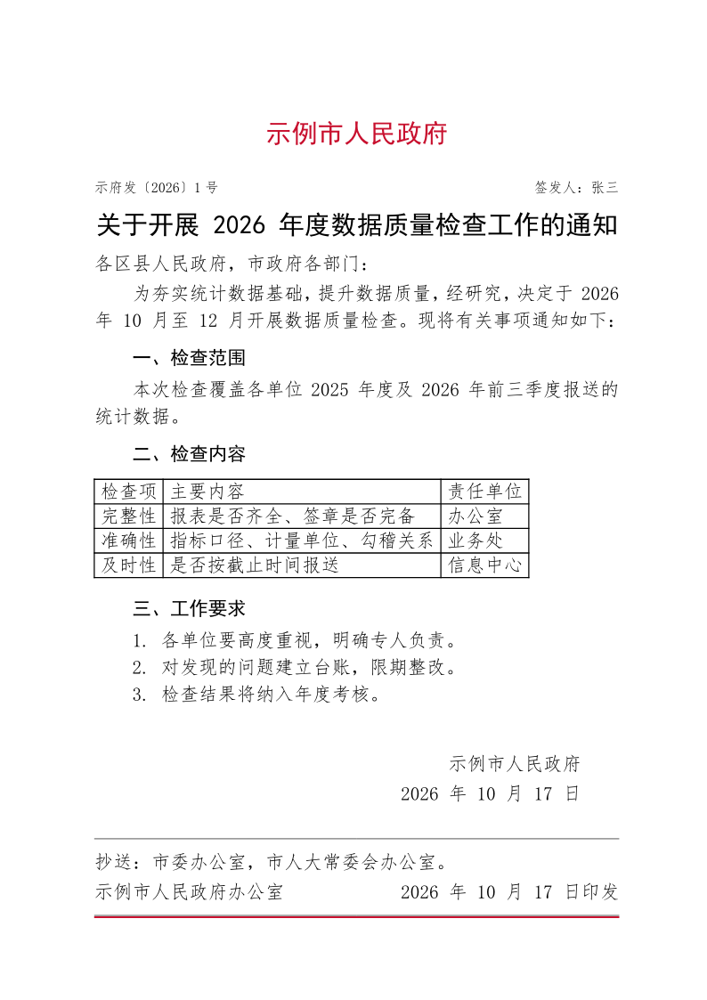
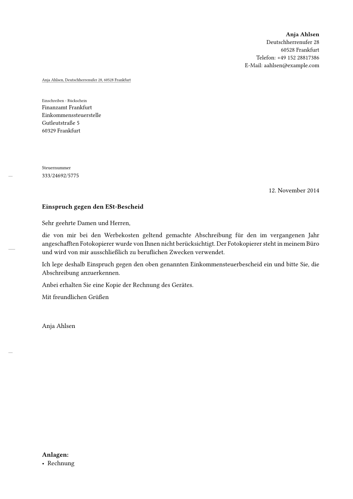
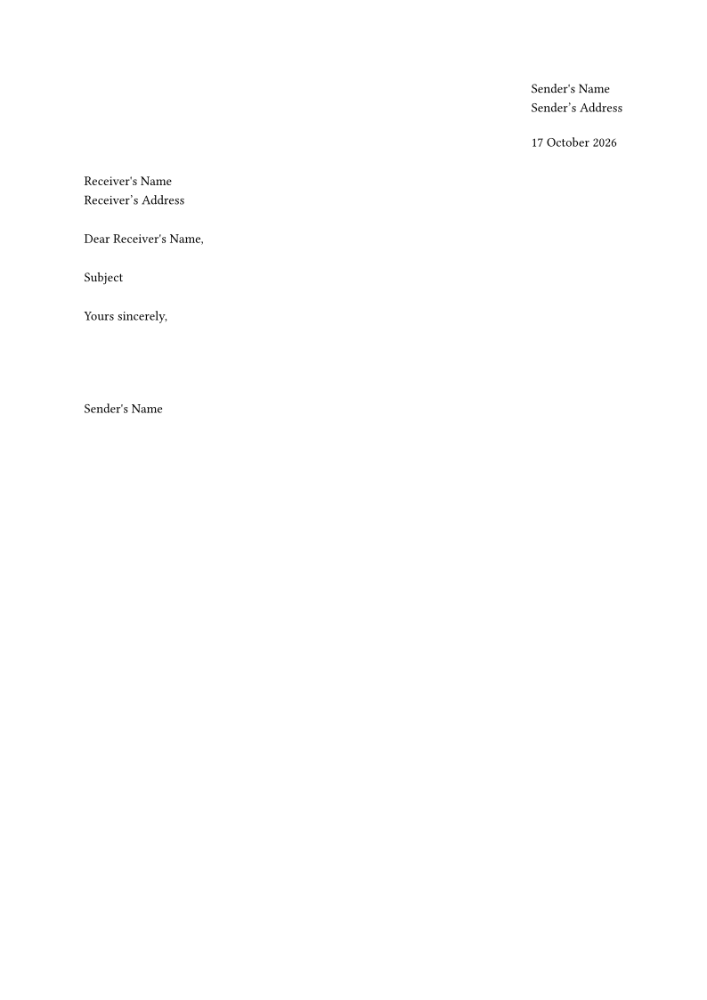
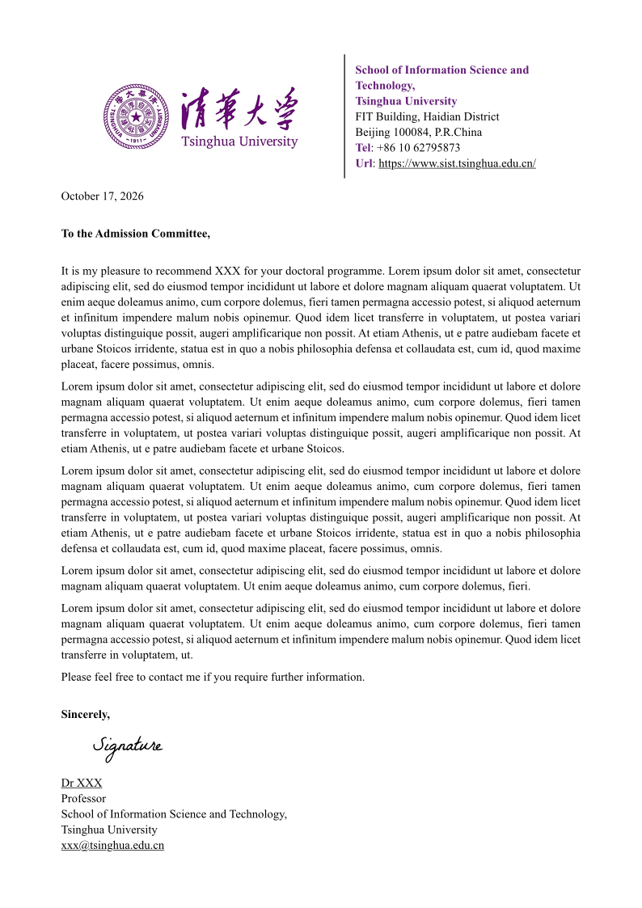

# 08-公文与书信

> GB/T 9704 中文公文、DIN 5008 商务信函、学术推荐信/求职信。

| 模板 | 版本 | 简介 | 入口 | 编译 |
|---|---|---|---|---|
| [`gbt9704-gongwen`](./gbt9704-gongwen/) | 0.2.0 | 适配 GB/T 9704-2012 公文格式模板 / adapts Chinese GB/T 9704-2012 document format template | [`template/main.typ`](<./gbt9704-gongwen/template/main.typ>) | ✓ |
| [`letter-pro`](./letter-pro/) | 3.0.0 | DIN 5008 letter template for Typst. | [`template/src/main.typ`](<./letter-pro/template/src/main.typ>) | ✓ |
| [`letterloom`](./letterloom/) | 3.0.2 | A highly customizable template for polished and professional letters. | [`template/main.typ`](<./letterloom/template/main.typ>) | ✓ |
| [`basic-academic-letter`](./basic-academic-letter/) | 0.2.0 | A clean template for academic letter | [`template/main.typ`](<./basic-academic-letter/template/main.typ>) | ✓ |

## 预览

> `gbt9704-gongwen` 上游是空白起步模板；预览由 `_预览/示例.typ` 生成，内容为虚构的公文示例。

> 编译状态为制作时在 Typst 0.15.1、Windows 中抽检的结果；缺少字体会产生 warning，不一定影响出 PDF。
