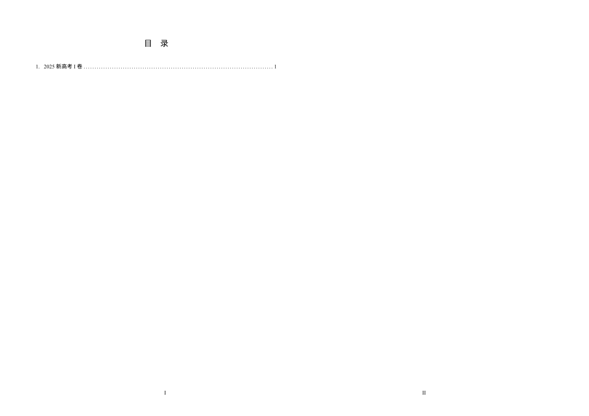
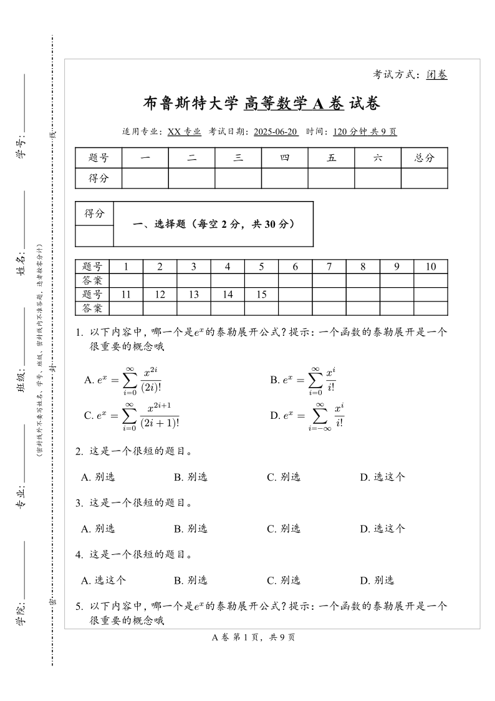
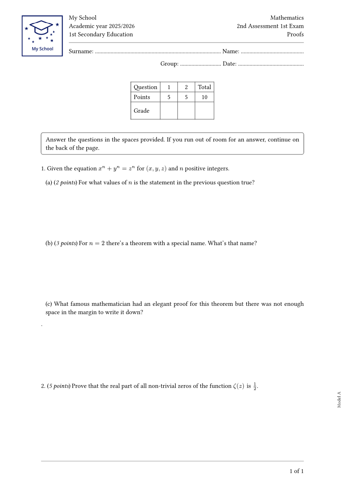
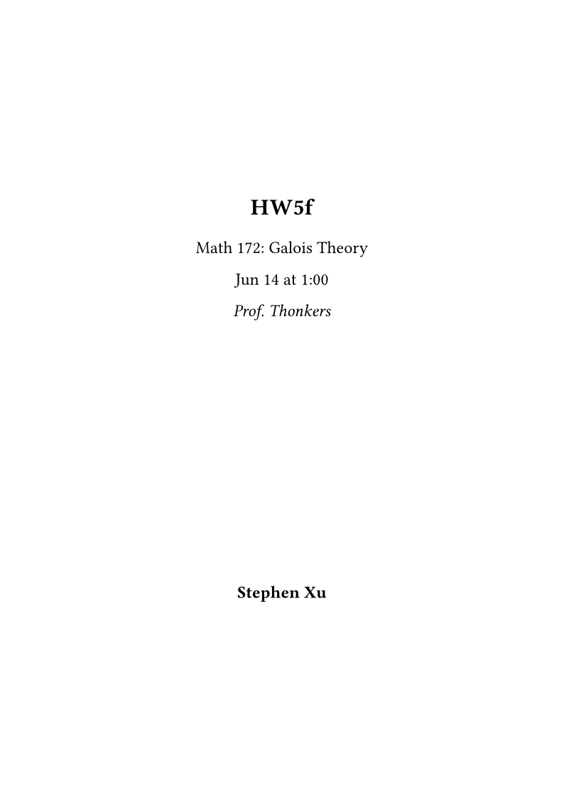
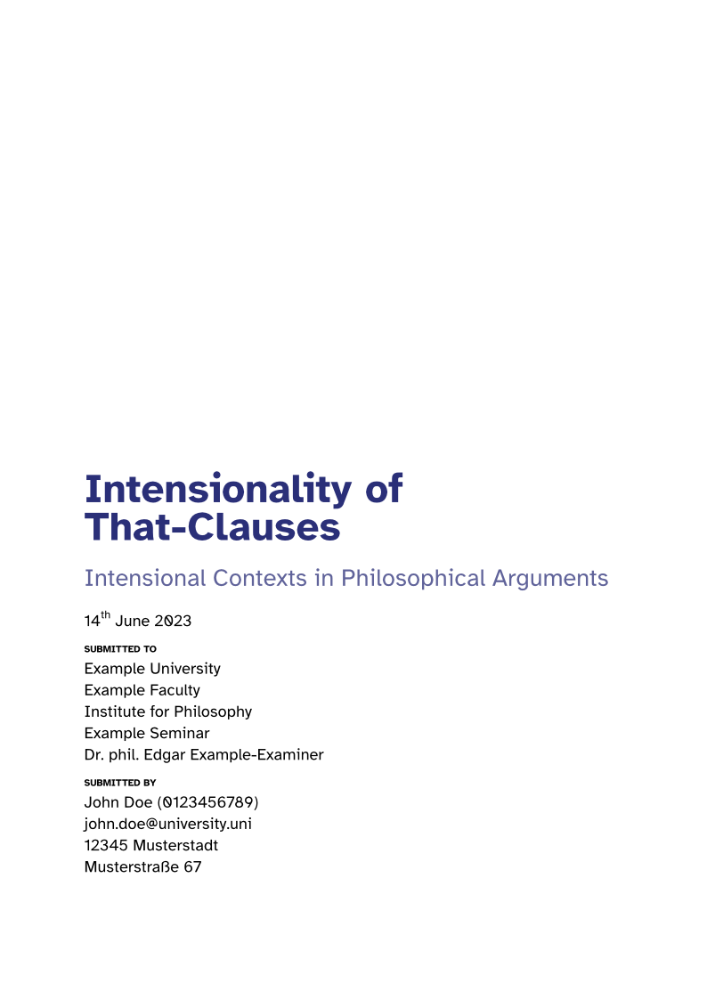
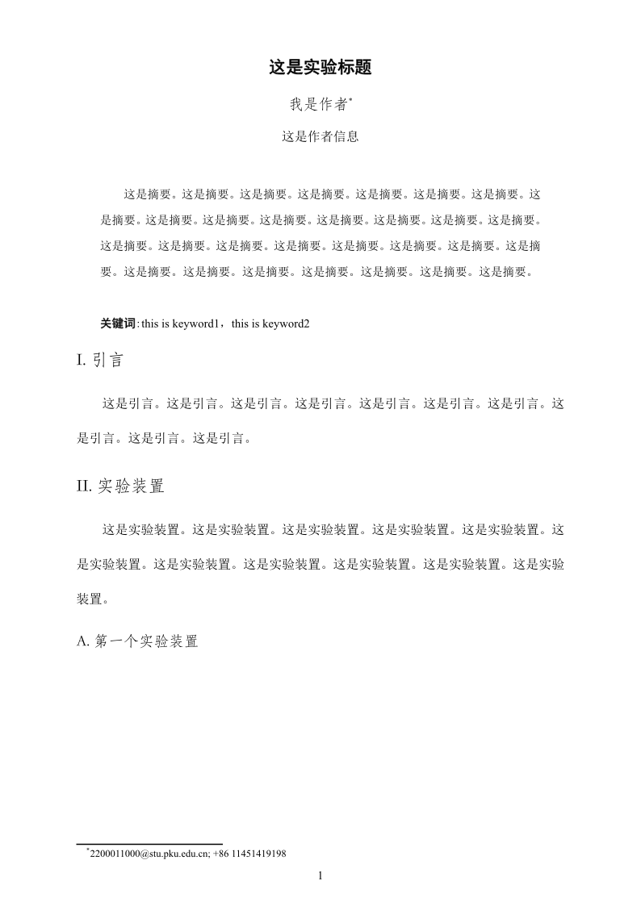
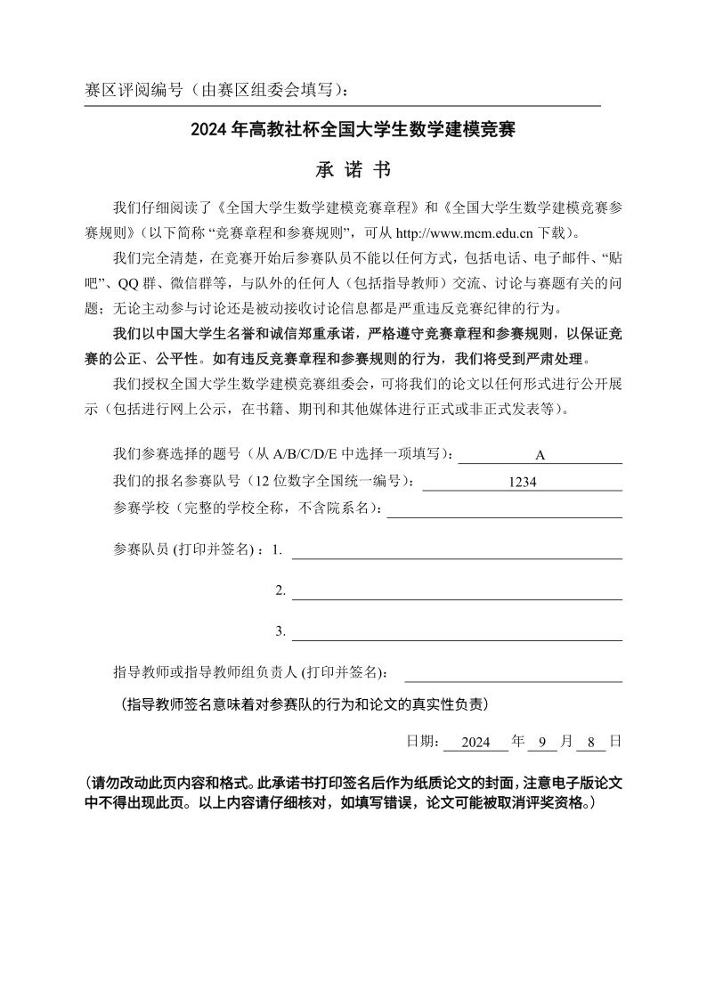
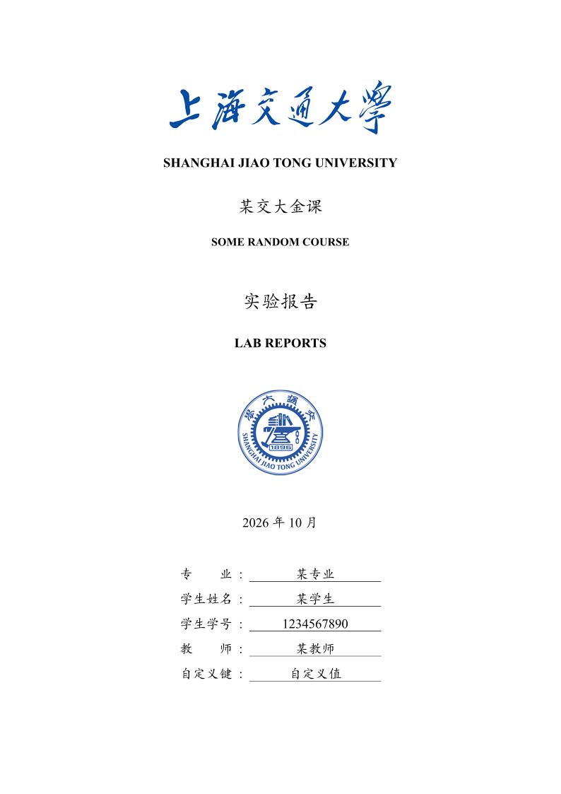

# 09-试卷作业与报告

> 考试卷、作业题、实验报告、数学建模与课程设计报告。

| 模板 | 版本 | 简介 | 入口 | 编译 |
|---|---|---|---|---|
| [`ezexam`](./ezexam/) | 0.3.1 | An exam template inspired by the LaTeX package exam-zh | [`template/main.typ`](<./ezexam/template/main.typ>) | ✓ |
| [`examora`](./examora/) | 0.2.0 | Template for examination paper: 考试试题模板 | [`template/exam.typ`](<./examora/template/exam.typ>) | ✓ |
| [`g-exam`](./g-exam/) | 0.4.5 | Create exams with student information, grade chart, score control, questions, and sub-questions. | [`template/1er exam.typ`](<./g-exam/template/1er exam.typ>) | ✓ |
| [`adaptable-pset`](./adaptable-pset/) | 0.2.0 | A flexible problem set template, perfect for technical courses. | [`template/main.typ`](<./adaptable-pset/template/main.typ>) | ✓ |
| [`grape-suite`](./grape-suite/) | 4.0.0 | Library of templates for exams, seminar papers, homeworks, etc. | [`src/template/main.typ`](<./grape-suite/src/template/main.typ>) | ✓ |
| [`meppp`](./meppp/) | 0.2.3 | Template for modern physics experiment reports at the Physics School of PKU. | [`template/main.typ`](<./meppp/template/main.typ>) | ✓ |
| [`cumcm-muban`](./cumcm-muban/) | 0.4.0 | 为高教社杯全国大学生数学建模竞赛设计的 Typst 模板 | [`template/main.typ`](<./cumcm-muban/template/main.typ>) | ✓ |
| [`modern-sjtu-report`](./modern-sjtu-report/) | 0.2.0 | A lab report template for SJTU in Typst. | [`template/main.typ`](<./modern-sjtu-report/template/main.typ>) | ✓ |

## 预览

> 编译状态为制作时在 Typst 0.15.1、Windows 中抽检的结果；缺少字体会产生 warning，不一定影响出 PDF。
